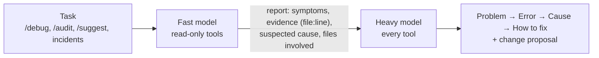
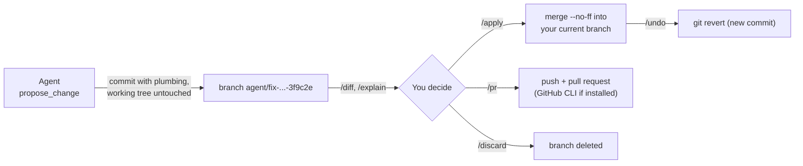
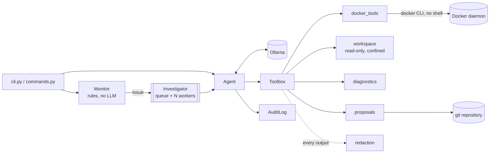

# DevOps Agent

🇧🇷 [Leia em português](README.pt-BR.md)

An autonomous DevOps agent that **debugs** your containers and your project with a **local LLM** (Ollama). It finds what is failing, explains each bug (the error, its cause and how to fix it) and **proposes the fix as a git branch** that you review and merge, or turn into a pull request.

- **Debugs end to end:** containers, container logs, project log files, Dockerfiles, compose, CI, configuration and code.
- **Explains like an engineer:** every problem comes as *Problem → Error → Cause → How to fix → Proposed change*.
- **Audits security:** 28 deterministic rules for Dockerfiles, compose, running containers, logs (brute force, attack probes) and secrets in the repository. It needs no model and works as a CI gate.
- **Two models (optional):** a fast model investigates with read-only tools; a heavy model checks the evidence, explains the problem and writes the fix.
- **Fixes through git:** each fix is a commit on its own `agent/...` branch. Your files are untouched until you run `/apply`, or you run `/pr` to open a pull request.
- **Private by default:** the model runs on your Ollama, so logs and code never leave your network.
- **Safe:**
  - there is no shell tool;
  - file access is confined to the project, and secret files are never read;
  - secrets are redacted before reaching the model;
  - container actions need your approval.
- **Parallel and auditable:** a queue of incidents is consumed by N workers, and every step is a JSON line in `logs/audit.jsonl`.
- **Bilingual:** English and Brazilian Portuguese.

> ⚠️ **No license yet.** The code is public to read, but until a license is added all rights are reserved.

---

## Contents

1. [Quick start](#quick-start)
2. [Debugging](#debugging)
3. [Security audit](#security-audit)
4. [Two models](#two-models)
5. [Chat commands](#chat-commands)
4. [Change proposals (git flow)](#change-proposals-git-flow)
5. [Architecture](#architecture)
6. [Module reference](#module-reference)
7. [Tools exposed to the model](#tools-exposed-to-the-model)
8. [Monitor rules](#monitor-rules)
9. [Agent loop](#agent-loop)
10. [Parallel investigations](#parallel-investigations)
11. [Security](#security)
12. [Configuration](#configuration)
13. [Languages](#languages)
14. [Running in Docker](#running-in-docker)
15. [Audit log](#audit-log)
16. [Testing](#testing)
17. [Demo environment](#demo-environment)
18. [Extending](#extending)
19. [Choosing a model](#choosing-a-model)
20. [Code conventions](#code-conventions)
21. [Known limitations](#known-limitations)
22. [Roadmap](#roadmap)
23. [Contributing](#contributing)

---

## Quick start

**Requirements:** Python 3.10+, Docker, git and [Ollama](https://ollama.com).

```bash
git clone https://github.com/umdevaprendiz/agents-DevOps.git
cd agents-DevOps
python -m venv .venv
source .venv/bin/activate          # Windows: .venv\Scripts\activate
pip install -e .
ollama pull qwen3:4b
cp .env.example .env               # optional: fill in only what you want to change
```

Then point the agent at **your** project (any git repository) and debug it:

```bash
cd /path/to/your/project           # or set AGENT_WORKSPACE
devops-agent debug                 # find what fails, explain it and propose fixes
devops-agent debug api timeout     # same, focused on a container, file or symptom
devops-agent chat                  # interactive: /debug, /diff, /explain, /apply, /pr...
devops-agent watch --scan-logs     # keep watching containers and investigate incidents
```

---

## Debugging

`devops-agent debug [focus]`, or `/debug [focus]` in the chat, runs a full debugging session:

1. **`collect_diagnostics`** gathers in one call, without the LLM:
   - containers with problems and their latest error lines;
   - error lines in the project's log files (`*.log`, including git-ignored ones);
   - the project's infrastructure files (Dockerfiles, compose, CI, Kubernetes, Terraform, nginx...).
2. **The model investigates each problem in depth:** container logs and `inspect`, plus the related project files (`read_file`, `search_files`, `git_diff`...).
3. **It explains every problem** in a fixed format:

   ```
   **Problem:** demo-web-unhealthy is marked unhealthy
   **Error:** wget: can't connect to remote host: Connection refused (healthcheck, 650 consecutive failures)
   **Cause:** the healthcheck probes http://localhost:8081/ but nginx listens on port 80
   **How to fix:** point the healthcheck to port 80 in docker-compose.yml, then run docker compose up -d web-unhealthy
   **Proposed change:** 3f9c2e
   ```

4. **When a file change fixes the problem, it calls `propose_change`** with the smallest edit. Restarting will not fix a config bug, so the agent is told not to suggest it in those cases. When the fix is an action, such as starting a database or setting a variable on the host, it gives the exact command.

Incidents found by `check`/`watch` follow the same path: diagnosis in that format, plus a proposed fix when a file change solves it.

---

## Security audit

`devops-agent audit` checks the project and the running containers against **28 rules**. It needs no model and no Ollama, runs in seconds and works as a CI gate. Every finding has a rule id, a severity, its location, the evidence (secrets always redacted) and how to fix it.

```bash
devops-agent audit                         # table in the terminal
devops-agent audit --fail-on medium        # exit code 1 when something is medium or worse
devops-agent audit --json --no-docker      # machine output for CI (always UTF-8)
```

| Area | Rules |
|---|---|
| Dockerfile | DF001 unpinned base image · DF002 runs as root · DF003 `curl \| sh` · DF004 secret in `ENV`/`ARG` · DF005 whole context copied without `.dockerignore` · DF006 no `HEALTHCHECK` · DF007 `apt-get` without `--no-install-recommends` · DF008 `chmod 777` |
| docker-compose | DC001 privileged · DC002 Docker socket mounted · DC003 secret in `environment` · DC004 database published on all interfaces · DC005 unpinned image · DC006 host network · DC007 ports without a healthcheck · DC008 no memory limit |
| Running containers | RC001 privileged · RC002 Docker socket mounted · RC003 database on all interfaces · RC004 runs as root · RC005 host network · RC006 no memory limit |
| Logs (containers and project `*.log`) | LG001 brute force (≥ 10 authentication failures, with the top source IPs) · LG002 attack probes (path traversal, SQL injection, scanners) · LG003 secret printed in clear text |
| Repository | SC001 hard-coded secret · SC002 secret file committed · SC003 secret file not ignored by git |

- **Severities and exit codes:** findings are `high`, `medium` or `low`. The command exits with 0 when nothing is at or above `--fail-on` (default `high`), 1 when something is, and 2 when the workspace is not found.
- **In the chat:** `/audit [focus]` (`/auditar`) runs the same audit through the model. It explains the high and medium findings in the *Problem → Error → Cause → How to fix* format, points out false positives and proposes fixes to files with `propose_change`.
- **Fewer false positives by design:**
  - redaction masks generously, but *reporting* a secret requires a known token format or a plausible literal (8+ characters, no spaces, not a `${VAR}` reference, path, code expression or placeholder);
  - tests, fixtures and docs are not scanned for secrets;
  - secret files are listed by name and never read;
  - globs are case-sensitive on every OS.
- **This repository audits itself in CI** with `--fail-on high`.

---

## Two models

Set `AGENT_FAST_MODEL` (or `--fast-model`) and investigative work runs in two stages, like a junior engineer who investigates and a senior who decides:



| Stage | Model | Tools | Output |
|---|---|---|---|
| Investigation | `AGENT_FAST_MODEL` | Read-only: diagnostics, audit, logs, inspect, files, git. No `propose_change`, no container actions | Report with *Symptoms*, *Evidence*, *Suspected cause*, *Files involved* and *Open questions*, shown in a dim panel |
| Resolution | `AGENT_MODEL` | Every tool | The final diagnosis and the fix proposal |

- **Where it applies:** `debug`, `/debug`, `/audit`, `/suggest` and the incidents from `check`/`watch`. Free chat, `ask` and `/explain` go straight to the main model, for faster answers.
- **Evidence first:** the analyst must use tools before reporting, and the resolver checks the key evidence and reads a file before changing it.
- **Optional:** without `AGENT_FAST_MODEL`, one model does everything, as before.
- **Visible:** the preflight checks both models, `/status` shows them, terminal lines are labeled with the model, and audit records carry `model` and `role` (`analyst` / `resolver`).

| Hardware | Fast model (investigation) | Heavy model (resolution) |
|---|---|---|
| CPU only | `qwen3:1.7b` (in a real run, `qwen2.5:1.5b` gathered the right evidence but drew the wrong conclusion) | `qwen3:4b` |
| GPU with 8–12 GB | `qwen3:4b` | `qwen3:8b` or `qwen3:14b` |
| GPU with 24 GB or more | `qwen3:8b` | `qwen3:32b` |

---

## Chat commands

`devops-agent chat` works like a coding assistant: you talk to the agent and use slash commands. Every command has an English name and a Portuguese alias.

| Command | Alias | What it does |
|---|---|---|
| `/help` | `/ajuda` | Lists the commands |
| `/debug [focus]` | `/depurar` | Finds what is failing (containers, logs, project), explains each bug and proposes fixes |
| `/audit [focus]` | `/auditar` | Runs the security audit; the agent explains the findings and proposes fixes |
| `/suggest [focus]` | `/sugerir` | Reviews the project and proposes **only necessary** changes (bugs, security risks, wrong config) |
| `/proposals` | `/propostas` | Lists pending proposals |
| `/diff [id]` | — | Shows the changes of a proposal (default: the latest) |
| `/explain [id]` | `/explicar` | The agent explains a proposal: what changes, why, risks, how to test |
| `/apply [id]` | `/aplicar` | Merges the proposal into your current branch (asks for confirmation) |
| `/pr [id]` | — | Pushes the proposal branch and opens a pull request (asks for confirmation) |
| `/discard [id]` | `/descartar` | Deletes a proposal |
| `/undo` | `/desfazer` | Reverts the last applied proposal with a new commit |
| `/status` | — | Model, language, workspace, branch and pending proposals |
| `/clear` | `/limpar` | Clears the conversation |
| `/exit` | `/sair`, `/quit` | Quits |

Anything that does not start with `/` is a normal question to the agent ("why is the worker restarting?", "is the nginx config safe?").

---

## Change proposals (git flow)



- **Each proposal is one commit on its own branch** `agent/<title-slug>-<id>`, authored by `DevOps Agent <devops-agent@users.noreply.localhost>`, so it is easy to tell apart from human commits.
- **Your working tree, index and current branch are never touched while proposing.** The commit is built with a temporary index (`read-tree` → `hash-object` → `update-index` → `write-tree` → `commit-tree`).
- **Edits are exact replacements:** `old_text` must appear once in the file, and `old_text=''` creates a new file. The store also handles CRLF files and line numbers that the model copied by mistake (`12| `). It refuses:
  - paths outside the workspace;
  - secret files;
  - lines containing `[REDACTED]`;
  - new text that looks like a secret (the model must use `${VARIABLE}` references instead).
- **`/apply`** runs `git merge --no-ff` with your own git identity and then deletes the proposal branch. If there is a conflict, the merge is aborted and your repository stays as it was.
- **`/undo`** reverts the last applied proposal with `git revert -m 1`, so history is kept.
- **`/pr`** asks for confirmation, then pushes the branch and runs `gh pr create` when the GitHub CLI is installed. Without it, the agent tells you which branch to open the PR from.
- **The agent never commits to your branch and never pushes on its own.**

---

## Architecture



### Project layout

```
devops_agent/
  cli.py           argument parsing, preflight, commands (chat, ask, debug, check, watch)
  commands.py      chat loop and slash commands; debug() and suggest() sessions
  agent.py         Agent: model → tool → result loop (role: resolver or analyst)
  pipeline.py      Team: fast model investigates, heavy model resolves
  tools.py         Tool, Toolbox and every tool exposed to the model
  docker_tools.py  Docker CLI wrapper
  workspace.py     confined, read-only access to the project files
  diagnostics.py   deterministic health report (containers, log files, infra files)
  security/        security audit: dockerfile, compose, runtime, logs, secrets, heuristics, audit
  git_tools.py     git CLI wrapper, including plumbing commits
  proposals.py     change proposals: create, diff, apply, pull request, discard, undo
  monitor.py       Issue, Monitor and detection rules
  workers.py       Investigator: queue + parallel worker threads
  redaction.py     secret masking
  audit.py         AuditLog (JSON Lines, thread-safe)
  ui.py            Rich console, confirmations, diff and table rendering
  config.py        Config and .env loading
  i18n.py, locales/  translations (en, pt-BR)
tests/             pytest suite
demo/              containers broken on purpose
```

---

## Module reference

| Module | Main pieces |
|---|---|
| `workspace.py` | **`Workspace`**: `resolve` (refuses escapes and secret files), `list_files`, `read_file` (numbered lines), `search` (regex, falls back to plain text), `git_status`/`git_log`/`git_diff` (secret files excluded), `log_files` and `tail_lines` (huge logs). **`WorkspaceError`**. |
| `diagnostics.py` | `collect(workspace)`: containers with problems plus their last error lines, project log files with errors, infrastructure files. |
| `git_tools.py` | `_git` (argument list, no shell, `GIT_TERMINAL_PROMPT=0`, bytes so CRLF is preserved); `commit_files` (plumbing commit with the agent identity); `merge`/`revert_merge` (abort on conflict); `branches`, `read_blob`, `push`... **`GitError`**. |
| `proposals.py` | **`ProposalStore`**: `create`, `pending`, `get`, `diff`, `apply`, `discard`, `undo_last`, `open_pull_request`. **`Proposal`**, **`Edit`**, `parse_edits` (accepts a list, a dict or a JSON string), `apply_edit`. **`ProposalError`**. |
| `commands.py` | **`Session`** (`agent` for chat, `team` for investigative commands), **`Command`**, `COMMANDS`, `dispatch`, `handle_input`, `run_chat`, `debug`, `suggest`, `security_review`, `ask_agent`. |
| `pipeline.py` | **`Team`**: `run(task)` sends the task to the analyst (fast model) when there is one, then hands its report to the resolver (heavy model); `reset()` clears both. **`Runner`** protocol (`run`, `reset`), shared by `Agent` and `Team`. |
| `tools.py` | **`Tool`**, **`Toolbox`**, `DOCKER_TOOLS`, `workspace_tools`, `diagnostics_tool`, `proposal_tool`, `build_toolbox`. |
| `agent.py` | **`Agent`**: `run(task, require_evidence)` plus small private steps (`_step`, `_execute`, `_approve`, `_invoke`...). It receives a `Toolbox`. |
| `monitor.py`, `workers.py`, `redaction.py`, `audit.py`, `config.py`, `i18n.py`, `ui.py`, `docker_tools.py` | Unchanged responsibilities: rules, the parallel queue, masking, audit, settings, translations, terminal and the Docker CLI. |

---

## Tools exposed to the model

| Tool | What it does | Approval |
|---|---|---|
| `collect_diagnostics()` | Starting point: containers with problems, log file errors, infrastructure files | — |
| `audit_security()` | The 28-rule security audit (see [Security audit](#security-audit)) | — |
| `list_containers`, `inspect_container`, `get_container_logs`, `get_container_stats` | Docker reads (`inspect` shows env var **names only**) | — |
| `list_files(pattern?)` | Project files (respects `.gitignore`; secret files hidden; up to 300) | — |
| `read_file(path, start_line?, max_lines?)` | File with numbered lines (`12| `), up to 500 lines, 512 KB max, text only | — |
| `search_files(pattern, glob?)` | Regex search across the project (`path:line: text`, up to 60 matches) | — |
| `git_status`, `git_log(limit?)`, `git_diff(path?)` | Repository state and uncommitted changes (secret files excluded) | — |
| `propose_change(title, explanation, edits)` | Commits a fix to a new `agent/...` branch; you decide later | — (you decide with `/apply` or `/pr`) |
| `restart_container`, `start_container`, `stop_container` | Container actions | **yes** |

---

## Monitor rules

Every rule that fires for a container is merged into one `Issue`.

| Rule | Condition |
|---|---|
| Restart loop | `status == "restarting"` |
| Dead | `status == "dead"` |
| Failed exit | `exited` and (`exit_code != 0` or `oom_killed`) and finished ≤ 24 h ago |
| Healthcheck | `running` and `health == "unhealthy"` |
| Restarted between scans | `running` and `restart_count` grew since the last scan |
| Loop on first scan | `running`, no history, `restart_count ≥ 3` and started ≤ 5 min ago |
| Log errors (`--scan-logs`) | `running` and ≥ 3 lines matching `ERROR_RE` inside the window |

`ERROR_RE` recognizes:
- upper-case levels (`ERROR`, `FATAL`, `CRITICAL`, `PANIC`);
- `Error:` / `TypeError:` / `Fatal:`;
- Go's `panic:`;
- Python tracebacks;
- `*Exception` names (`RuntimeException`, `NullPointerException`...);
- structured `level=error` / `"level":"error"`.

---

## Agent loop

1. **Start:** appends the task, trims old history and audits `task`.
2. **Round:** calls `chat` with the toolbox, `temperature=0.1`, `num_ctx` and `think=False`, then strips any reasoning, including qwen3's reasoning that ends in a lone `</think>`.
3. **Tool calls:** native `tool_calls`; if there are none, it looks for a JSON call written in the text and accepts only known tool names.
4. **Execution:**
   - An unknown tool returns the list of valid ones.
   - Container actions ask for approval.
   - Every output is **redacted**, truncated and sent back as `role="tool"`.
5. **Evidence:** for incidents, an answer given without using any tool is rejected once.
6. **End:** the answer uses the *Problem / Error / Cause / How to fix / Proposed change* format for problems, and plain answers otherwise.
7. **Limit:** after `max_steps` rounds, one last call without tools forces an answer.

---

## Parallel investigations

`check` and `watch` hand every `Issue` to the `Investigator`:
- N worker threads (`AGENT_WORKERS` / `--workers`, default 2) investigate different containers at once.
- A container that is already queued or under investigation is not queued again.
- Each investigation gets its own `Agent`, labeled with the container name: output lines look like `[api] → ...` and audit records carry the same `run` id.
- Approvals are asked one at a time.

> More workers only help if the LLM backend serves requests in parallel (Ollama with `OLLAMA_NUM_PARALLEL` and a GPU). On a CPU-only machine, use `--workers 1`.

---

## Security

Full policy in **[SECURITY.md](SECURITY.md)**.

| Threat | Mitigation |
|---|---|
| The model running arbitrary commands | No shell tool; Docker and git always run with fixed argument lists; validated container names |
| The model reading or leaking secrets | Workspace confined to its root; `.env*` (except `.env.example`), private keys, `.netrc`, `.npmrc`, `.pypirc`, `.git/` are never read, listed, searched or diffed; every tool output is redacted |
| The model writing secrets into the repo | `propose_change` refuses new text that looks like a secret and lines containing `[REDACTED]`; the prompt asks for `${VARIABLE}` references |
| The model changing your code without consent | Proposals live on separate branches; only `/apply` (with confirmation) merges, and `/undo` reverts |
| Pushing without consent | Only `/pr`, after confirmation; git never waits for credential prompts |
| The model breaking containers | Every container action needs approval; the default answer is **no** |
| Prompt injection through logs or files | A small, typed tool set; nothing changes without your approval |

---

## Configuration

Environment variables or a `.env` file (copy `.env.example`, which holds **names only**). Real variables win over the file.

| Variable | Default | Description |
|---|---|---|
| `AGENT_WORKSPACE` | current directory | Project the agent debugs and proposes changes to (a git repository) |
| `AGENT_MODEL` | `qwen3:4b` | Main Ollama model (resolution and chat) |
| `AGENT_FAST_MODEL` | unset | Faster model for the investigation stage; unset = one model does everything |
| `AGENT_LANGUAGE` | system language | `en` or `pt-BR` |
| `AGENT_WORKERS` | `2` | Parallel investigations |
| `AGENT_MAX_STEPS` | `12` | Max model → tool rounds per task |
| `AGENT_NUM_CTX` | `8192` | Context window requested from Ollama |
| `AGENT_MAX_TOOL_OUTPUT` | `4000` | Max characters of each tool output |
| `AGENT_AUDIT_FILE` | `logs/audit.jsonl` | Audit log path |
| `OLLAMA_HOST` | `http://localhost:11434` | Ollama server |
| `DOCKER_HOST` / `DOCKER_CONTEXT` | Docker defaults | Which daemon to debug |

```
devops-agent [--model MODEL] [--fast-model MODEL] [--lang en|pt-BR] {chat,ask,debug,audit,check,watch} ...
```

| Command | Options | Behavior |
|---|---|---|
| `chat` | — | Interactive session with slash commands |
| `ask QUESTION...` | — | One question, one answer |
| `debug [FOCUS...]` | — | Full debugging session; prints proposals to review in the chat |
| `audit` | `--fail-on high\|medium\|low\|never`, `--json`, `--no-docker` | Security audit without the model; exit code 1 when a finding reaches `--fail-on` |
| `check` | `--only a,b`, `--scan-logs`, `--workers N` | One scan; investigates every incident in parallel |
| `watch` | the same, plus `--interval 30` and `--cooldown 600` | Continuous scanning |

The preflight checks Docker, the model in Ollama and the workspace. A folder without git still works, but change proposals are disabled.

---

## Languages

The model's answers, the CLI, the slash commands and `--help` are translated. The language is chosen in this order:
1. `--lang`
2. `AGENT_LANGUAGE`
3. the OS locale
4. `LANG`/`LC_*`
5. English

To add a language, copy `locales/en.py`, translate it and register it in `i18n.py`. `tests/test_i18n.py` guarantees the same keys and placeholders in every language, and that every key is used.

---

## Running in Docker

```bash
docker build -t devops-agent .
docker run -it --rm \
  -v /var/run/docker.sock:/var/run/docker.sock \
  --group-add "$(stat -c '%g' /var/run/docker.sock)" \
  --add-host=host.docker.internal:host-gateway \
  -e OLLAMA_HOST=http://host.docker.internal:11434 \
  -v "$PWD:/workspace" -e AGENT_WORKSPACE=/workspace \
  devops-agent debug
```

- `-it` is needed for confirmations.
- The image runs as the non-root user `agent` (UID 10001). On Docker Desktop, use `--group-add 0` if the socket gives *permission denied*.
- ⚠️ Mounting the Docker socket is equivalent to root on the host. Prefer a remote `DOCKER_HOST` with TLS, or a socket proxy that allows only the endpoints the agent uses.

---

## Audit log

JSON Lines. Every event has `ts`, `event`, `run` (one id per task) and `subject` (the container, when there is one).

| `event` | Extra fields |
|---|---|
| `task` | `task`, `model` |
| `tool` | `tool`, `args`, `ok`, `output` (first 500 characters, redacted) |
| `approval` | `tool`, `args`, `approved` |
| `answer` | `answer` |

---

## Testing

```bash
pip install -e ".[dev]"
pytest                          # everything
pytest -m "not integration"     # without touching Docker (what CI runs)
```

Unit tests need **neither Docker nor Ollama**: they use test doubles (`FakeClient`, `assistant()`, `make_info()`, `fake_tools`, `docker_calls`, `fake_docker`). Git tests use real temporary repositories (fixture `git_repo`).

| File | Covers |
|---|---|
| `test_agent.py` | Loop, tool calls written as JSON text, approvals, errors, step limit, evidence, `think` fallback, reasoning cleanup, redaction, labels, audit |
| `test_workspace.py` | Confinement (`../`, absolute paths), secret files, `.gitignore`, numbered reading, size and binary limits, search, `git_diff` without secrets |
| `test_git_tools.py` | Plumbing commits that never touch the working tree, agent identity, executable bit, CRLF, merge/revert, conflicts aborted |
| `test_proposals.py` | Exact edits (unique, ambiguous, CRLF, line numbers), secret guards, subfolder workspaces, apply/undo/discard, push to a remote, **end to end: the model proposes and the operator applies** |
| `test_diagnostics.py` | Containers with errors, Docker down, git-ignored log files, huge logs, infrastructure files |
| `test_pipeline.py` | The analyst receives the task with evidence required, the resolver receives the analyst's report, single-model mode is unchanged, reset clears both |
| `test_security_*.py` | Every audit rule fires on a bad example and stays quiet on a hardened one; false positives that were found and fixed (translation keys, `os.environ[...]`, `${VAR}`, `dockerfile.py` on Windows); exit codes and UTF-8 JSON |
| `test_commands.py` | Every command and alias, `/debug`, `/suggest`, `/diff`, `/explain` (no secrets sent), confirmations for `/apply`, `/pr`, `/discard`, `/undo` |
| `test_cli.py`, `test_workers.py`, `test_monitor.py`, `test_docker_tools.py`, `test_tools.py`, `test_redaction.py`, `test_config.py`, `test_i18n.py`, `test_audit.py` | CLI, parallel queue, rules and `ERROR_RE`, Docker wrapper, toolbox, masking (including `${VAR}` references), `.env`, translations, audit |

CI runs:
- the unit tests on Python 3.10 to 3.13;
- gitleaks over the whole history;
- a Docker image build.

---

## Demo environment

`demo/docker-compose.yml` starts four containers with known defects. Run `devops-agent debug` inside this repository to watch the agent explain them and propose fixes.

| Container | Defect | Expected diagnosis |
|---|---|---|
| `demo-web` | none | (no alert) |
| `demo-web-unhealthy` | healthcheck probes 8081, nginx listens on 80 | Wrong healthcheck port → proposal editing `docker-compose.yml` |
| `demo-api` | Postgres does not exist | Restarting won't help; the database is missing |
| `demo-worker` | `QUEUE_URL` missing, `restart: always` | Set the environment variable |

---

## Extending

- **A tool:** add a `Tool` in `tools.py`. Read-only tools need no approval. Container actions use `_action_tool`, which enforces approval. File changes must go through `propose_change`.
- **A chat command:** add a `Command(name, aliases, usage, help_key, handler)` to `commands.COMMANDS` and its texts to both catalogs.
- **A detection rule:** add a small function to `monitor.py` and include it in `Monitor._check`.
- **An approval channel:** `Agent` receives an `Approver = Callable[[Tool, dict], bool]`.

---

## Choosing a model

| Model | `demo-web-unhealthy` on a CPU-only machine |
|---|---|
| `llama3.2:3b` | ❌ Invented an OOM kill; once it fabricated a whole `docker inspect` output |
| `qwen3:4b` (default) | ✅ Found the wrong healthcheck port and that restarting won't help; in a `debug` session it proposed the exact fix (`8081` → `80` in `docker-compose.yml`) on its own branch; slow on a CPU |

Code changes need more context and reasoning than diagnosis. With a GPU, a larger model (such as `qwen3:8b` and up) gives much better proposals. To keep the investigation fast, pair it with a small model through [Two models](#two-models).

---

## Code conventions

- **English code**, with every text going through `t()` in `locales/`.
- **Small, single-purpose functions** and `UPPER_CASE` constants.
- **Expected errors become values** for the model (tool errors, refused edits).
- **No shell, ever:** subprocesses always receive argument lists.
- **Few dependencies:** `ollama` and `rich`.

---

## Known limitations

- **Speed on a CPU:** a debugging session can take several minutes.
- **Hallucinations:** small models still invent details. Proposals and actions always wait for you.
- **Exact-replacement edits:** big refactors are out of scope by design ("only necessary changes").
- **Terminal confirmations:** there are no timeouts or remote approval channels yet.
- **In-memory state:** the queue, cooldown and restart counters live in one process.
- **Redaction is regex-based:** custom secret formats may get through.
- **Docker only:** there is no Kubernetes support yet.

---

## Roadmap

- [x] Test suite and CI
- [x] Public-repository security (redaction, `.env` names only, gitleaks)
- [x] English and Brazilian Portuguese
- [x] Installable package and Docker image
- [x] Parallel investigations
- [x] Debugging sessions (`debug`, `/debug`, `collect_diagnostics`)
- [x] Slash commands and change proposals on git branches (`/diff`, `/explain`, `/apply`, `/pr`, `/undo`)
- [ ] Permission modes (only suggest / ask / automatic) and per-tool policies
- [ ] Approval channels with timeouts (webhook, Slack, Telegram)
- [ ] LLM providers: any OpenAI-compatible API (vLLM, LM Studio...)
- [x] Security audit: Dockerfiles, compose, running containers, logs and repository secrets (`audit`, `/audit`)
- [x] Two models: a fast one investigates, a heavy one resolves (`AGENT_FAST_MODEL`)
- [ ] Persistent state and a distributed queue
- [ ] Multiple Docker hosts, then Kubernetes
- [ ] `/health`, Prometheus metrics, HTTP API

---

## Contributing

```bash
pip install -e ".[dev]"
pre-commit install          # gitleaks on every commit
pytest
```

- Keep functions small and code in English.
- Put every new text in **both** catalogs.
- Never commit real values.
- Report vulnerabilities privately, as described in [SECURITY.md](SECURITY.md).
