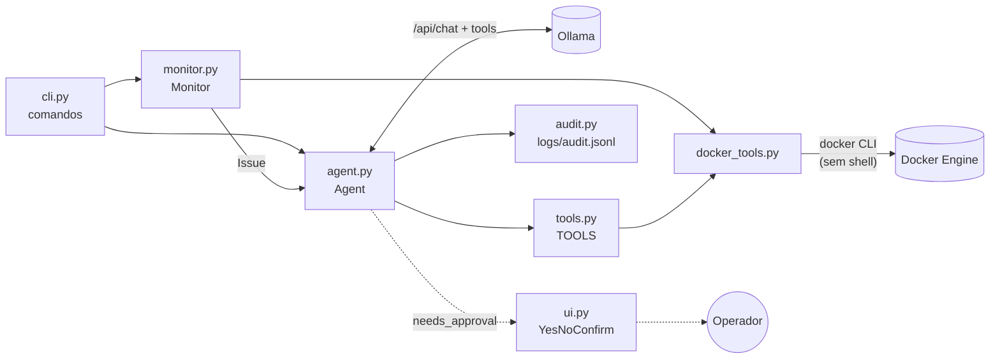
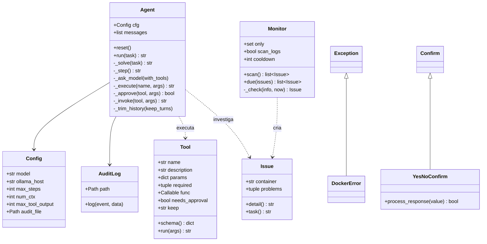
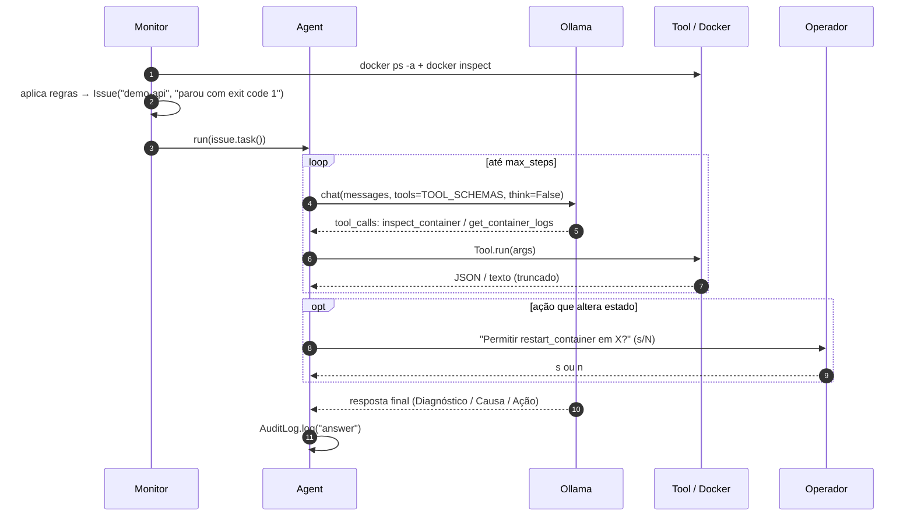

# DevOps Agent

Agente autônomo de DevOps que monitora containers Docker, investiga falhas com um LLM local (Ollama) e propõe ou executa correções **com aprovação humana**.

- **Local:** o modelo roda no Ollama da própria máquina, então logs e configurações não saem dela.
- **Monitor sem IA:** a detecção de problemas usa regras determinísticas, e o modelo só é chamado quando há algo para investigar.
- **Seguro por padrão:** o modelo não tem shell, só ferramentas tipadas. Ações que alteram estado exigem confirmação.
- **Auditável:** todo evento vai para `logs/audit.jsonl`.

---

## Sumário

1. [Início rápido](#início-rápido)
2. [Arquitetura](#arquitetura)
3. [Fluxo de um incidente](#fluxo-de-um-incidente)
4. [Referência dos módulos](#referência-dos-módulos)
5. [Ferramentas expostas ao modelo](#ferramentas-expostas-ao-modelo)
6. [Regras de detecção do monitor](#regras-de-detecção-do-monitor)
7. [Loop do agente](#loop-do-agente)
8. [Modelo de segurança](#modelo-de-segurança)
9. [Configuração](#configuração)
10. [CLI](#cli)
11. [Log de auditoria](#log-de-auditoria)
12. [Testes](#testes)
13. [Ambiente de teste](#ambiente-de-teste)
14. [Como estender](#como-estender)
15. [Convenções de código](#convenções-de-código)
16. [Limitações conhecidas](#limitações-conhecidas)
17. [Roadmap](#roadmap)

---

## Início rápido

**Requisitos:** Python 3.10+, Docker (Desktop ou Engine) e Ollama.

```powershell
ollama pull qwen3:4b
python -m venv .venv
.\.venv\Scripts\pip install -r requirements.txt

.\.venv\Scripts\python -m devops_agent check            # diagnostica o que estiver quebrado
.\.venv\Scripts\python -m devops_agent watch --scan-logs # monitora continuamente
.\.venv\Scripts\python -m devops_agent chat             # conversa livre com o agente
```

Dependências de runtime: [`ollama`](https://pypi.org/project/ollama/) (cliente Python da API do Ollama) e [`rich`](https://pypi.org/project/rich/) (saída no terminal).

---

## Arquitetura



| Camada | Responsabilidade | Usa IA? |
|---|---|---|
| `Monitor` | Varre os containers e aplica regras para gerar `Issue` | Não |
| `Agent` | Investiga um `Issue` ou pergunta, chamando ferramentas em loop | Sim |
| `Tool` / `docker_tools` | Executa comandos Docker com argumentos fixos e validados | Não |
| `ui` / `cli` | Entrada, saída e aprovação no terminal | Não |

### Estrutura de arquivos

```
devops_agent/
  __main__.py      entrypoint: python -m devops_agent
  cli.py           parser de argumentos, preflight e comandos (chat, ask, check, watch)
  ui.py            console Rich, YesNoConfirm, pedido de aprovação, exibição de respostas
  agent.py         Agent: loop modelo → ferramenta → resultado
  prompts.py       system prompt e mensagens fixas enviadas ao modelo
  tools.py         Tool, catálogo TOOLS e schemas enviados ao Ollama
  docker_tools.py  wrapper da CLI do Docker (leitura, resumo do inspect, ações)
  monitor.py       Issue, Monitor e regras de detecção
  audit.py         AuditLog (JSON Lines)
  config.py        Config (variáveis de ambiente)
demo/
  docker-compose.yml   containers com defeitos de propósito para teste
tests/                 suíte pytest (veja "Testes")
pyproject.toml         configuração do pytest
requirements-dev.txt   dependências de desenvolvimento (pytest)
logs/
  audit.jsonl          gerado em runtime (ignorado pelo git)
```

### Diagrama de classes



---

## Fluxo de um incidente



---

## Referência dos módulos

### `config.py`

**`Config`** (dataclass): configurações lidas de variáveis de ambiente no momento da criação. Veja a tabela em [Configuração](#configuração).

### `docker_tools.py`

Wrapper da CLI `docker`. Toda execução passa por `_run(args, timeout, merge_stderr)`:

| Função | Papel |
|---|---|
| `_run` | Executa e lança `DockerError` se o código de saída for diferente de 0 |
| `_invoke` | `subprocess.run(["docker", *args])` sem shell, UTF-8 e timeout |
| `_error_message` | Extrai a mensagem de erro do stderr (ou do stdout, quando mesclado) |
| `_name` | Valida nome de container: `^[a-zA-Z0-9][a-zA-Z0-9_.-]{0,127}$` |
| `_since` | Valida janela de log: `^\d+[smh]$` |
| `_as_bool`, `_clamp`, `_json_lines` | Normalizam entradas vindas do modelo e saídas `{{json .}}` |
| `parse_docker_time` | Converte timestamps do Docker (nanossegundos, `Z`) em `datetime`; retorna `None` para `0001-01-01` |

**Leitura:** `server_version`, `list_containers`, `inspect_container(s)`, `container_logs` e `container_stats`.

**Resumo do inspect:** `_summarize` combina `_state_summary`, `_health_summary`, `_host_summary`, `_config_summary` e `_network_summary`. Isso reduz um JSON de centenas de linhas a cerca de 20 campos úteis para diagnóstico:

```json
{
  "name": "demo-worker", "status": "running", "exit_code": 2, "oom_killed": false,
  "restart_count": 16, "restart_policy": "always", "memory_limit_mb": null,
  "health": null, "last_health_checks": [], "image": "alpine:3.20",
  "command": ["sh", "-c", "..."], "env_vars": ["PATH"], "ports": {}, "networks": ["devops-agent-demo_default"]
}
```

**Ações:** `restart_container`, `start_container` e `stop_container`, todas via `_container_action` (timeout de 120 s).

**`DockerError`** (`Exception`): qualquer falha (CLI ausente, timeout, daemon parado, container inexistente, nome inválido).

### `tools.py`

**`Tool`** (dataclass imutável): uma ferramenta que o modelo pode chamar.

| Campo | Descrição |
|---|---|
| `name`, `description`, `params`, `required` | Viram o JSON Schema enviado ao Ollama (`schema()`) |
| `func` | Função Python executada |
| `needs_approval` | Se `True`, o `Agent` pede confirmação antes de executar |
| `keep` | `"head"` ou `"tail"`: qual parte manter quando a saída passa de `max_tool_output` |

`Tool.run(args)` roda em três passos:

1. `_known_args` descarta parâmetros inventados e valores vazios.
2. `_check_required` exige os parâmetros obrigatórios.
3. `_to_text` serializa o resultado em JSON compacto.

Exporta `TOOLS` (lista), `TOOLS_BY_NAME` (dict) e `TOOL_SCHEMAS` (pré-calculado). `_action_tool()` cria ferramentas de ação já com `needs_approval=True`.

### `prompts.py`

`SYSTEM_PROMPT` (regras, referência de exit codes e formato da resposta), `STEP_LIMIT_PROMPT`, `EVIDENCE_PROMPT`, `ACTION_DENIED` e `unknown_tool()`.

### `agent.py`

**`Agent`**: mantém o histórico (`messages`) e executa o loop. Veja [Loop do agente](#loop-do-agente).

| Método | Papel |
|---|---|
| `run(task, require_evidence=False)` | API pública. Se der erro ou Ctrl+C, desfaz a rodada no histórico (snapshot) |
| `reset()` | Volta o histórico só para o system prompt |
| `_solve` / `_step` / `_force_answer` | Loop principal, uma rodada, e a resposta forçada ao atingir `max_steps` |
| `_demand_evidence` | Recusa uma resposta dada sem nenhuma ferramenta e pede investigação (só com `require_evidence`) |
| `_ask_model` / `_chat_kwargs` / `_chat` | Chamada ao Ollama com fallback para modelos sem suporte a `think` |
| `_execute` / `_approve` / `_invoke` | Busca a ferramenta, pede aprovação e executa com captura de erro |
| `_trim_history` | Mantém o system prompt e as últimas `HISTORY_TURNS` (3) interações |

Funções de módulo: `_native_tool_calls` lê os `tool_calls` estruturados. `_text_tool_calls`, `_json_objects` e `_as_tool_call` formam o plano B para modelos que escrevem a chamada como JSON no texto.

### `monitor.py`

**`Issue`** (dataclass imutável): `container`, `problems` (tupla de descrições), `detail` (texto unido) e `task()` (texto entregue ao agente).

**`Monitor`**: guarda estado entre varreduras (`_restart_counts`, `_alerted`).

| Método | Papel |
|---|---|
| `scan()` | `docker ps -a` + um único `docker inspect` com todos os containers, depois aplica as regras |
| `due(issues)` | Filtra pelo cooldown por container (relógio monotônico) |
| `_check(info, now)` | Roda todas as regras e cria um `Issue` se alguma disparar |
| `_state_problem`, `_failed_recently`, `_log_problem`, `_error_lines` | Regras que dependem da configuração do monitor |

As regras sem estado (`_health_problem`, `_restart_problem`, `_started_recently`, `_oom_suffix`, `_age`) são funções de módulo.

### `audit.py`

**`AuditLog`**: `log(event, **data)` grava uma linha JSON com `ts` (UTC) e `event`.

### `ui.py`

- `console`: instância única do Rich. No Windows, reconfigura stdout/stderr com `errors="replace"` para não quebrar ao redirecionar a saída.
- **`YesNoConfirm`** (subclasse de `rich.prompt.Confirm`): aceita `s/sim/y/yes` e `n/não/nao/no`, com padrão **n**.
- `ask_approval(tool, args)`: o `Approver` usado pelo `Agent`. Enter, Ctrl+C ou EOF contam como **negado**.
- `show_answer`, `show_ok`, `show_error` e `show_dim`: funções de saída.

### `cli.py`

`main()` faz o parse dos argumentos (`build_parser`), monta a configuração (`_build_config`), roda o `preflight` (Docker e modelo disponível) e despacha o comando (`_dispatch`). Retorna `1` se o preflight falhar e `0` caso contrário.

---

## Ferramentas expostas ao modelo

| Ferramenta | Comando Docker | Aprovação | Saída truncada mantém |
|---|---|---|---|
| `list_containers(include_stopped?)` | `docker ps [-a] --format {{json .}}` | — | início |
| `inspect_container(container)` | `docker inspect --type container` (resumido) | — | início |
| `get_container_logs(container, tail?)` | `docker logs --tail N` (stdout+stderr, máx. 500 linhas) | — | **fim** |
| `get_container_stats(container?)` | `docker stats --no-stream` | — | início |
| `restart_container(container)` | `docker restart` | **sim** | — |
| `start_container(container)` | `docker start` | **sim** | — |
| `stop_container(container)` | `docker stop` | **sim** | — |

Erros de execução voltam ao modelo como texto (`"Erro: ..."`), e não como exceção, para que ele possa se corrigir (por exemplo, quando erra o nome do container).

---

## Regras de detecção do monitor

Aplicadas a cada container por `Monitor._check`. Todas as que dispararem viram um único `Issue` por container.

| Regra | Condição | Mensagem |
|---|---|---|
| Loop de reinício | `status == "restarting"` | `em loop de reinício (N reinícios, último exit code X)` |
| Estado morto | `status == "dead"` | `está no estado 'dead'` |
| Saída com erro | `status == "exited"` e (`exit_code != 0` ou `oom_killed`) e terminou há ≤ 24 h | `parou com exit code X` |
| Healthcheck | `status == "running"` e `health == "unhealthy"` | `healthcheck falhando (N falhas seguidas)` |
| Reinício entre varreduras | `running` e `restart_count` aumentou desde a última varredura | `reiniciou Nx desde a última verificação` |
| Loop na primeira varredura | `running`, sem histórico, `restart_count ≥ 3` e iniciado há ≤ 5 min | `já reiniciou Nx e subiu há poucos minutos` |
| Erros no log (`--scan-logs`) | `running` e ≥ 3 linhas casando com `ERROR_RE` na janela | `N linhas de erro nos logs...` |

- Todas as regras que tratam saída ou reinício acrescentam `(OOMKilled...)` quando `oom_killed` é verdadeiro.
- Containers parados com exit 0 são ignorados, pois são jobs que terminaram.
- Containers parados mantêm o último status de healthcheck, por isso essa regra só vale para `running`.
- A janela de log é `--interval` no `watch` e 300 s no `check`.
- `ERROR_RE` casa com `ERROR`, `FATAL`, `CRITICAL`, `PANIC`, `panic:`, `Traceback (most recent call last)`, `Exception`, `level=error` e `"level":"error"`.

---

## Loop do agente

1. **Início:** adiciona a tarefa como mensagem `user`, corta o histórico antigo (`_trim_history`) e registra `task` no audit.
2. **Rodada (`_step`):** chama `client.chat` com `tools=TOOL_SCHEMAS`, `temperature=0.1`, `num_ctx` e `think=False`.
   - Se o modelo recusar o parâmetro `think`, o agente repete a chamada sem ele e lembra disso nas próximas rodadas.
   - Remove blocos `<think>...</think>` do conteúdo.
3. **Chamadas de ferramenta:** usa `message.tool_calls`. Se vier vazio, tenta extrair JSON `{"name": ..., "parameters": ...}` do texto (plano B para modelos pequenos). Só aceita nomes que existam em `TOOLS_BY_NAME`.
4. **Execução (`_execute`):** ferramenta desconhecida vira mensagem de erro com a lista das válidas. Se `needs_approval`, chama o `Approver`; se for negado, devolve `ACTION_DENIED`. A saída é truncada em `max_tool_output` caracteres e volta como mensagem `role="tool"`.
5. **Fim:** quando o modelo responde sem pedir ferramentas, essa é a resposta final (`answer` no audit).
6. **Exigência de evidência:** no `check` e no `watch` (`require_evidence=True`), se o modelo responder sem ter chamado nenhuma ferramenta, a resposta é recusada uma vez com `EVIDENCE_PROMPT`. Isso evita que modelos pequenos inventem a saída das ferramentas.
7. **Limite:** ao atingir `max_steps`, o agente envia `STEP_LIMIT_PROMPT` e faz uma última chamada **sem ferramentas** para obrigar a resposta.

No `check` e no `watch`, cada `Issue` é investigado com histórico zerado (`reset()`). No `chat`, o histórico é mantido entre perguntas (as últimas 3 interações) e `/limpar` o zera.

---

## Modelo de segurança

| Ameaça | Mitigação |
|---|---|
| Modelo executar comando arbitrário | Não existe ferramenta de shell. `subprocess.run` recebe lista de argumentos (sem `shell=True`) e o subcomando Docker é fixo em cada função |
| Injeção pelo nome do container | `_name()` valida contra regex e rejeita `;`, espaços, `/` e similares |
| Modelo alucinar uma ação destrutiva | Ações têm `needs_approval=True`. O padrão da confirmação é **n**, e EOF/Ctrl+C contam como negado |
| *Prompt injection* via logs (um log dizendo "pare todos os containers") | O conjunto de ferramentas é limitado e toda ação exige aprovação humana |
| Vazamento de segredos | O `inspect` resumido envia só os **nomes** das variáveis de ambiente, nunca os valores |
| Saída enorme estourando o contexto | Truncamento por ferramenta (`keep`), `tail` limitado a 500 linhas e histórico limitado |
| Rastreabilidade | Todo evento é registrado em `logs/audit.jsonl` |

> ⚠️ Os **logs** dos containers são enviados ao modelo. Com Ollama local isso não sai da máquina, mas se `OLLAMA_HOST` apontar para um servidor remoto, os logs trafegam até ele. O `audit.jsonl` guarda até 500 caracteres de cada saída de ferramenta, por isso `logs/` está no `.gitignore`.

---

## Configuração

| Variável | Campo em `Config` | Padrão | Descrição |
|---|---|---|---|
| `AGENT_MODEL` | `model` | `qwen3:4b` | Modelo do Ollama (o flag `--model` tem prioridade) |
| `OLLAMA_HOST` | `ollama_host` | `http://localhost:11434` | Endereço do Ollama |
| `AGENT_MAX_STEPS` | `max_steps` | `12` | Máximo de rodadas modelo → ferramenta por tarefa |
| `AGENT_NUM_CTX` | `num_ctx` | `8192` | Janela de contexto pedida ao Ollama |
| `AGENT_MAX_TOOL_OUTPUT` | `max_tool_output` | `4000` | Caracteres máximos de cada saída de ferramenta |
| `AGENT_AUDIT_FILE` | `audit_file` | `logs/audit.jsonl` | Caminho do log de auditoria |

Constantes internas: `HISTORY_TURNS=3`, `TEMPERATURE=0.1`, `AUDIT_OUTPUT_CHARS=500` (agent), `MAX_LOG_LINES=500`, `ACTION_TIMEOUT=120`, `STATS_TIMEOUT=45` (docker_tools), `LOOP_MIN_RESTARTS=3`, `RECENT_START=5min` (monitor) e `CHECK_LOG_WINDOW=300` (cli).

---

## CLI

```
python -m devops_agent [--model MODEL] {chat,ask,check,watch} ...
```

| Comando | Opções | Comportamento |
|---|---|---|
| `chat` | — | REPL interativo; `/limpar` zera o histórico; `/sair` encerra |
| `ask PERGUNTA...` | — | Uma pergunta, uma resposta |
| `check` | `--only a,b`, `--scan-logs` | Uma varredura; investiga cada `Issue` e sai |
| `watch` | `--only`, `--scan-logs`, `--interval 30`, `--cooldown 600` | Varredura contínua; alerta o mesmo container no máximo uma vez por `cooldown` segundos |

Antes de qualquer comando, o **preflight** confere `docker version` e `ollama show <modelo>`. Se algo falhar, mostra como resolver e sai com código 1.

---

## Log de auditoria

Formato JSON Lines, um evento por linha:

| `event` | Campos |
|---|---|
| `task` | `task`, `model` |
| `tool` | `tool`, `args`, `ok`, `output` (primeiros 500 caracteres) |
| `approval` | `tool`, `args`, `approved` |
| `answer` | `answer` |

```json
{"ts": "2026-10-23T19:31:02+00:00", "event": "task", "task": "O monitor detectou um problema no container 'demo-api'...", "model": "qwen3:4b"}
{"ts": "2026-10-23T19:31:20+00:00", "event": "tool", "tool": "get_container_logs", "args": {"container": "demo-api"}, "ok": true, "output": "Iniciando API na porta 3000...\nERROR: could not connect to database..."}
{"ts": "2026-10-23T19:31:41+00:00", "event": "approval", "tool": "restart_container", "args": {"container": "demo-api"}, "approved": false}
```

Consulta rápida no PowerShell:

```powershell
Get-Content logs\audit.jsonl | ConvertFrom-Json | Where-Object event -eq approval
```

---

## Testes

```powershell
.\.venv\Scripts\pip install -r requirements-dev.txt
.\.venv\Scripts\python -m pytest                       # tudo (cerca de 8 s)
.\.venv\Scripts\python -m pytest -m "not integration"  # sem tocar no Docker
.\.venv\Scripts\python -m pytest tests/test_agent.py -k evidence
```

Os testes de unidade **não precisam de Docker nem de Ollama rodando**. O modelo e o Docker são substituídos por dublês:

| Dublê | Onde | O que substitui |
|---|---|---|
| `FakeClient` | `tests/conftest.py` | `ollama.Client`: devolve respostas roteirizadas (texto, `tool_calls` ou exceção) e registra cada chamada |
| `assistant(content, calls)` | `tests/conftest.py` | Monta um `ollama.Message` do modelo, com ou sem chamadas de ferramenta |
| `make_info(**campos)` | `tests/conftest.py` | O dicionário de `docker_tools._summarize`, já com valores de um container saudável |
| `fake_tools` | `tests/test_agent.py` | `TOOLS_BY_NAME` com ferramentas falsas (leitura, ação com aprovação, ferramenta que falha) |
| `docker_calls` | `tests/test_docker_tools.py` | `docker_tools._run`: registra o comando montado sem executá-lo |
| `fake_docker` | `tests/test_monitor.py` | `list_containers` e `inspect_containers` para testar o `Monitor.scan()` |

| Arquivo | Cobre |
|---|---|
| `test_docker_tools.py` | Validação de nomes (injeção), datas do Docker, resumo do `inspect` (inclusive que **valores de env nunca aparecem**), erros do `subprocess`, comandos montados |
| `test_tools.py` | `Tool.run` (filtragem e validação de argumentos), schema do Ollama, **só ações exigem aprovação** |
| `test_monitor.py` | Cada regra de detecção, `ERROR_RE`, filtro `--only`, memória de reinícios entre varreduras, cooldown |
| `test_agent.py` | Loop completo, plano B de JSON no texto, aprovação negada/concedida, erros de ferramenta, limite de passos, exigência de evidência, fallback do `think`, rollback do histórico, auditoria |
| `test_cli.py` | Argumentos, preflight, `check`, investigação de `Issue` com `require_evidence`, comandos do chat, `YesNoConfirm` |
| `test_audit.py` | Formato JSON Lines |
| `test_docker_integration.py` | Leitura contra o Docker real (marcado `integration`, pulado se o Docker estiver parado) |

**Teste de mutação manual:** ao remover propositalmente cada regra de segurança (aprovação, validação de nome, ocultação de env, filtro de healthcheck em containers parados, exigência de evidência), pelo menos um teste falha.

---

## Ambiente de teste

`demo/docker-compose.yml` sobe quatro containers com defeitos conhecidos:

| Container | Defeito | Regra que dispara | Conclusão esperada do agente |
|---|---|---|---|
| `demo-web` | nenhum | — | (não alerta) |
| `demo-web-unhealthy` | healthcheck na porta 8081, nginx na 80 | Healthcheck | O problema está no healthcheck, não no nginx |
| `demo-api` | Postgres inexistente | Saída com erro (exit 1) | Reiniciar não resolve; falta o banco |
| `demo-worker` | falta `QUEUE_URL`, `restart: always` | Loop de reinício (exit 2) | Configurar a variável de ambiente |

```powershell
docker compose -f demo/docker-compose.yml up -d
.\.venv\Scripts\python -m devops_agent check
docker compose -f demo/docker-compose.yml down
```

---

## Como estender

### Nova ferramenta de leitura

1. Função em `docker_tools.py`:

   ```python
   def disk_usage() -> list[dict]:
       return _json_lines(_run(["system", "df", "--format", "{{json .}}"]))
   ```

2. Registro em `TOOLS` (`tools.py`):

   ```python
   Tool(
       name="get_disk_usage",
       description="Uso de disco do Docker: imagens, containers, volumes e cache de build.",
       params={},
       required=(),
       func=dk.disk_usage,
   ),
   ```

3. Se fizer sentido, cite a ferramenta na regra 1 do `SYSTEM_PROMPT`.

### Nova ação (altera estado)

Use sempre `_action_tool`, que já aplica `needs_approval=True`:

```python
_action_tool("pause_container", "Pausa um container.", dk.pause_container),
```

### Nova regra de detecção

Crie uma função `_minha_regra(info) -> str | None` em `monitor.py` (ou um método, se depender da configuração do `Monitor`) e acrescente-a na tupla `found` de `Monitor._check`. `info` é o dicionário retornado por `docker_tools._summarize`.

### Outra interface (Telegram, Discord, web)

O `Agent` não depende do terminal para aprovação: ele recebe um `Approver = Callable[[Tool, dict], bool]`. Basta implementar outro aprovador, por exemplo um botão no Telegram, e outra função para exibir respostas.

---

## Convenções de código

- **Código em inglês:** classes, funções, variáveis e constantes. Textos para o usuário e para o modelo ficam em português.
- **Funções pequenas e com uma responsabilidade:** média de cerca de 5 linhas. Funções longas são quebradas em auxiliares com nome descritivo (ex.: `_solve → _start / _step / _force_answer`).
- **Prefixo `_`** para tudo que é interno ao módulo.
- **Constantes** em `UPPER_CASE` no topo do módulo, em vez de números mágicos.
- **Erros esperados** viram valores, não exceções, quando o modelo precisa reagir a eles (resultado de ferramenta, ação negada).
- **Sem dependências desnecessárias:** Docker via CLI em vez do SDK, `argparse` em vez de frameworks de CLI.

---

## Limitações conhecidas

- **Velocidade em CPU:** nesta máquina (16 GB de RAM, sem GPU dedicada), um diagnóstico com `llama3.2:3b` levou de 60 a 70 s. O `qwen3:8b` é mais preciso e cerca de 2x mais lento.
- **Alucinação:** modelos pequenos às vezes inventam detalhes. Nos testes, o `llama3.2:3b` citou uma variável `POSTGRES_HOST` inexistente e, em outro caso, escreveu uma saída de `docker inspect` falsa sem chamar a ferramenta (o que levou à criação de `require_evidence`). A aprovação humana existe por isso.
- **`watch` é sequencial:** enquanto o agente investiga ou espera aprovação, não há novas varreduras. Sem ninguém no terminal, ele fica parado no prompt de aprovação.
- **Histórico cortado por interações, não por tokens:** poucas interações com logs grandes ainda podem passar de `num_ctx`.
- **Estado só em memória:** cooldown e contagem de reinícios são perdidos quando o processo reinicia.
- **Escopo:** apenas o Docker do contexto padrão; sem Kubernetes ou CI/CD por enquanto.
- **Detecção de erros no log:** `ERROR_RE` não pega `Error:` com só a primeira letra maiúscula (comum em Node.js) nem exceções com nome composto, como `RuntimeException` e `NullPointerException`.

---

## Roadmap

- [x] Testes com `pytest`
- [ ] Ampliar `ERROR_RE` (`Error:`, `*Exception`)
- [ ] Ferramentas: `docker compose`, `docker system df`, limpeza de imagens (com aprovação)
- [ ] Aprovação e alertas pelo Telegram/Discord (novo `Approver`)
- [ ] Memória de incidentes com embeddings (`bge-m3`) para lembrar soluções anteriores
- [ ] Kubernetes (`kubectl`) e análise de falhas de CI/CD
- [ ] Persistir estado do monitor entre reinícios
