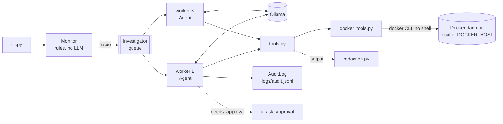
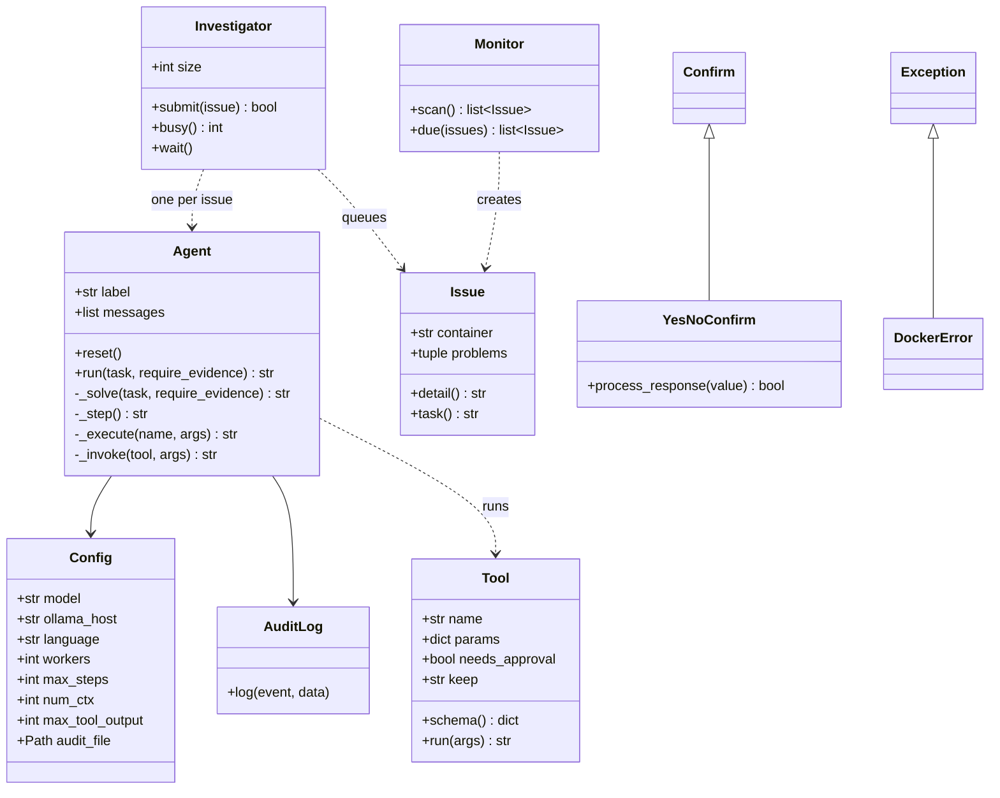
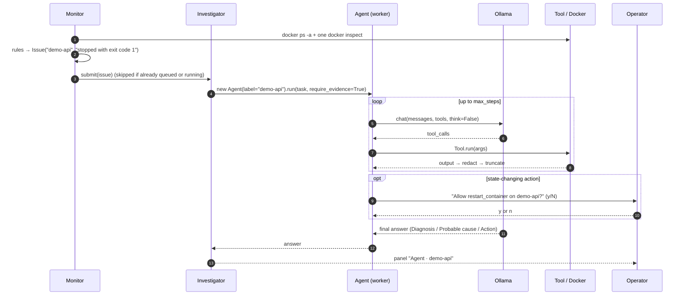

# DevOps Agent

[](https://github.com/umdevaprendiz/agents-DevOps/actions/workflows/ci.yml)

🇧🇷 [Leia em português](README.pt-BR.md)

An autonomous DevOps agent that watches Docker containers, investigates failures with a **local LLM** (Ollama) and proposes or applies fixes **with human approval**.

- **Private by default:** the model runs on your own Ollama, so logs never leave your network.
- **Cheap detection:** problems are found by deterministic rules; the LLM is only called when something is wrong.
- **Parallel:** detected incidents go into a queue consumed by N workers, and scanning never stops while investigations run.
- **Safe:** there is no shell tool, arguments are validated, every state change needs human approval, and secrets are redacted before they reach the model or the disk.
- **Auditable:** every task, tool call, approval and answer is a JSON line in `logs/audit.jsonl`.
- **Bilingual:** English and Brazilian Portuguese, covering the agent's answers, the CLI and the docs.

> ⚠️ **No license yet.** The code is public to read, but until a license is added all rights are reserved.

---

## Contents

1. [Quick start](#quick-start)
2. [Architecture](#architecture)
3. [Incident flow](#incident-flow)
4. [Module reference](#module-reference)
5. [Tools exposed to the model](#tools-exposed-to-the-model)
6. [Monitor rules](#monitor-rules)
7. [Agent loop](#agent-loop)
8. [Parallel investigations](#parallel-investigations)
9. [Security](#security)
10. [Configuration](#configuration)
11. [Languages](#languages)
12. [Running in Docker](#running-in-docker)
13. [Audit log](#audit-log)
14. [Testing](#testing)
15. [Demo environment](#demo-environment)
16. [Extending](#extending)
17. [Choosing a model](#choosing-a-model)
18. [Code conventions](#code-conventions)
19. [Known limitations](#known-limitations)
20. [Roadmap](#roadmap)
21. [Contributing](#contributing)

---

## Quick start

**Requirements:** Python 3.10+, Docker and [Ollama](https://ollama.com).

```bash
git clone https://github.com/umdevaprendiz/agents-DevOps.git
cd agents-DevOps
python -m venv .venv
source .venv/bin/activate          # Windows: .venv\Scripts\activate
pip install -e .

ollama pull qwen3:4b
cp .env.example .env               # optional: fill in only what you want to change

devops-agent check                 # scan once and investigate whatever is broken
devops-agent watch --scan-logs     # keep watching
devops-agent chat                  # free conversation with the agent
```

Runtime dependencies: [`ollama`](https://pypi.org/project/ollama/) (Python client) and [`rich`](https://pypi.org/project/rich/) (terminal output).

---

## Architecture



| Layer | Responsibility | Uses the LLM? |
|---|---|---|
| `Monitor` | Scans containers and applies rules that produce `Issue`s | No |
| `Investigator` | Queue plus worker threads; one investigation per container at a time | No |
| `Agent` | Investigates an `Issue` or a question, calling tools in a loop | Yes |
| `Tool` / `docker_tools` | Runs Docker commands with fixed, validated arguments | No |
| `redaction` | Hides secrets in tool outputs, log examples and audit records | No |
| `ui` / `cli` / `i18n` | Terminal I/O, approvals and translations | No |

### Project layout

```
devops_agent/
  __main__.py      python -m devops_agent
  cli.py           argument parsing, preflight, commands (chat, ask, check, watch)
  ui.py            Rich console, YesNoConfirm, approval prompt, answer rendering
  agent.py         Agent: model → tool → result loop
  workers.py       Investigator: queue + parallel worker threads
  monitor.py       Issue, Monitor and detection rules
  tools.py         Tool, the TOOLS catalog and the schemas sent to Ollama
  docker_tools.py  Docker CLI wrapper (reads, inspect summary, actions)
  redaction.py     secret masking
  audit.py         AuditLog (JSON Lines, thread-safe)
  config.py        Config and .env loading
  i18n.py          t(), language detection
  locales/         en.py, pt_br.py (message catalogs)
tests/             pytest suite (see "Testing")
demo/              containers broken on purpose
Dockerfile         runtime image (non-root)
.env.example       variable names only, no values
SECURITY.md        security policy and how to report vulnerabilities
```

### Class diagram



---

## Incident flow



---

## Module reference

### `config.py`

- **`Config`** (dataclass): settings read from the environment when it is created. Empty values count as unset, so the empty lines of `.env.example` are harmless.
- `load_env_file(path=None)` loads `KEY=VALUE` lines into `os.environ` without overriding variables that are already set. The default location is `.env`, or `AGENT_ENV_FILE`. It understands comments, `export`, quotes and values containing `=`.

### `docker_tools.py`

Everything goes through `_run(args, timeout, merge_stderr)`, which calls `subprocess.run(["docker", *args])` (no shell) and raises **`DockerError`** on a non-zero exit, a missing CLI or a timeout.

| Function | Role |
|---|---|
| `_name`, `_since` | Validate the container name (`^[a-zA-Z0-9][a-zA-Z0-9_.-]{0,127}$`) and the log window (`^\d+[smh]$`) |
| `_as_bool`, `_clamp`, `_json_lines` | Normalize values coming from the model and `{{json .}}` output |
| `parse_docker_time` | Parses Docker timestamps (nanoseconds, `Z`); returns `None` for `0001-01-01` |
| `list_containers`, `inspect_container(s)`, `container_logs`, `container_stats` | Read-only commands |
| `_summarize` → `_state/_health/_host/_config/_network_summary` | Reduce `docker inspect` to about 20 fields; env vars keep **names only** |
| `restart/start/stop_container` → `_container_action` | Actions (120 s timeout) |

Because the Docker CLI honors `DOCKER_HOST` and `DOCKER_CONTEXT`, the agent can watch a remote daemon.

### `tools.py`

**`Tool`** (frozen dataclass): `name`, `description`, `params`, `required`, `func`, `needs_approval` and `keep` (`"head"`/`"tail"`, the part kept when truncating). `run(args)` drops invented or empty arguments (`_known_args`), checks the required ones (`_check_required`) and serializes the result (`_to_text`).
`_action_tool()` builds state-changing tools that always have `needs_approval=True`. The module exports `TOOLS`, `TOOLS_BY_NAME` and `TOOL_SCHEMAS`. Tool descriptions stay in English, which models follow most reliably.

### `agent.py`

**`Agent`**: one conversation with the model. It is not thread-safe, so the system creates one per investigation.

| Method | Role |
|---|---|
| `run(task, require_evidence=False)` | Public API. Gives each run a `run_id`; on error or Ctrl+C it rolls the history back |
| `reset()` | Resets the history to the system prompt of the current language |
| `_solve` / `_step` / `_force_answer` | Main loop, one round, and the forced answer when `max_steps` is reached |
| `_demand_evidence` | Rejects an answer given without any tool (only with `require_evidence`) |
| `_ask_model` / `_chat_kwargs` / `_chat` | Ollama call; retries without `think` for models that don't support it |
| `_execute` / `_approve` / `_invoke` | Tool lookup, approval, execution, **redaction** and truncation |
| `_print` / `_audit` | Output prefixed with `[label]`; audit events carry `run` and `subject` |
| `_trim_history` | Keeps the system prompt plus the last `HISTORY_TURNS` (3) turns |

Module functions:
- `_clean` removes `<think>` blocks, including reasoning that ends in a lone `</think>` (qwen3 does this).
- `_native_tool_calls` reads structured tool calls.
- `_text_tool_calls`, `_json_objects` and `_as_tool_call` handle models that write the call as JSON in plain text.

### `workers.py`

**`Investigator`**: a `queue.Queue` consumed by `size` daemon threads.
- `submit(issue)` returns `False` when that container is already queued or under investigation.
- `busy()` counts queued plus running investigations.
- `wait()` polls until everything is done, so Ctrl+C still works on Windows.
- A failure in one investigation is reported through `on_error` and never kills the worker.

### `monitor.py`

**`Issue`** (frozen dataclass) holds `container` and `problems`, plus `detail` and `task()` (translated). **`Monitor`** offers `scan()` (one `docker ps` plus one `docker inspect` for all containers) and `due(issues)` (cooldown per container). Rules live in small functions: `_state_problem`, `_health_problem`, `_restart_problem` and `_log_problem`. Log examples are redacted.

### `redaction.py`

`redact(text)` applies the masking rules. `redact_data(value)` walks dicts and lists and hides the whole value under keys that look sensitive (`DB_PASSWORD`, `api_key`, `token`...). The replacement is always `[REDACTED]`.

### `audit.py`

**`AuditLog`**: `log(event, **data)` writes one JSON line with `ts` (UTC) and `event`. It uses a lock (safe with parallel workers), omits `None` fields and redacts every record.

### `i18n.py` and `locales/`

`t(key, **values)` returns the text in the current language and falls back to English. `detect_language()` picks the language (see [Languages](#languages)). Catalogs are plain dicts in `locales/en.py` and `locales/pt_br.py`.

### `ui.py` and `cli.py`

- **`ui.py`:** `console`; **`YesNoConfirm`**, which shows `y/n` or `s/n` and accepts both; `ask_approval`, which is serialized by a lock so parallel workers take turns at the terminal; `show_answer(answer, label)`; `spinner` for chat.
- **`cli.py`:** `main()` loads `.env`, applies `--lang`, builds the parser with translated help, runs the preflight (Docker plus the model in Ollama) and dispatches. It returns `1` when the preflight fails.

---

## Tools exposed to the model

| Tool | Docker command | Approval | Long output keeps |
|---|---|---|---|
| `list_containers(include_stopped?)` | `docker ps [-a] --format {{json .}}` | — | start |
| `inspect_container(container)` | `docker inspect --type container` (summarized) | — | start |
| `get_container_logs(container, tail?)` | `docker logs --tail N` (stdout+stderr, max 500 lines) | — | **end** |
| `get_container_stats(container?)` | `docker stats --no-stream` | — | start |
| `restart_container(container)` | `docker restart` | **yes** | — |
| `start_container(container)` | `docker start` | **yes** | — |
| `stop_container(container)` | `docker stop` | **yes** | — |

Execution errors go back to the model as text (`"Error: ..."`) so it can correct itself, for example after a wrong container name.

---

## Monitor rules

Every rule that fires for a container is merged into a single `Issue`.

| Rule | Condition |
|---|---|
| Restart loop | `status == "restarting"` |
| Dead | `status == "dead"` |
| Failed exit | `status == "exited"` and (`exit_code != 0` or `oom_killed`) and finished ≤ 24 h ago |
| Healthcheck | `status == "running"` and `health == "unhealthy"` |
| Restarted between scans | `running` and `restart_count` grew since the last scan |
| Loop on first scan | `running`, no history, `restart_count ≥ 3` and started ≤ 5 min ago |
| Log errors (`--scan-logs`) | `running` and ≥ 3 lines matching `ERROR_RE` inside the window |

- Containers that exited with code 0 are ignored, because they are finished jobs.
- Stopped containers keep their last health status, which is why the healthcheck rule only applies to `running` ones.
- The log window is `--interval` for `watch` and 300 s for `check`.
- The cooldown (default 600 s) avoids alerting about the same container on every scan.

---

## Agent loop

1. **Start:** appends the task, trims old history and audits `task`.
2. **Round:** calls `chat` with `tools`, `temperature=0.1`, `num_ctx` and `think=False`, then strips any reasoning from the answer.
3. **Tool calls:** reads `message.tool_calls`. If there are none, it looks for a JSON call in the text and accepts only names that exist in `TOOLS_BY_NAME`.
4. **Execution:**
   - An unknown tool returns an error that lists the valid ones.
   - An action with `needs_approval` asks the operator first; if denied, it returns "Action DENIED".
   - The output is redacted, truncated to `max_tool_output` characters and appended as `role="tool"`.
5. **Evidence:** for incidents (`require_evidence=True`), an answer given without any tool is rejected once.
6. **End:** an answer without tool calls is the final answer.
7. **Limit:** after `max_steps` rounds, the agent sends one last call **without tools** that forces an answer.

---

## Parallel investigations

`check` and `watch` hand every `Issue` to the `Investigator`:

- **N workers** (`AGENT_WORKERS` or `--workers`, default 2) investigate different containers at the same time.
- **The scanner keeps running** during investigations, and a container already queued or under investigation is not queued again.
- **One `Agent` per investigation**, labeled with the container name. Terminal lines look like `[demo-api] → inspect_container(...)` and every audit event carries the same `run` id.
- **Terminal approvals are serialized:** only one prompt at a time.
- **Ctrl+C exits immediately:** worker threads are daemons.

> More workers only help if the LLM backend serves requests in parallel. With Ollama, set `OLLAMA_NUM_PARALLEL` and use a GPU; on a CPU-only machine, requests queue inside Ollama anyway.

---

## Security

The full policy and how to report vulnerabilities are in **[SECURITY.md](SECURITY.md)**. In short:

| Threat | Mitigation |
|---|---|
| The model running arbitrary commands | No shell tool; fixed argument lists (`shell=False`); validated container names |
| The model breaking something | Every action requires approval; the default answer is **no**; Enter, Ctrl+C and EOF all mean no |
| Prompt injection through logs ("stop all containers") | A small, typed tool set, and approval for every action |
| Secrets in logs reaching the model or disk | `redaction.py` runs on every tool output, log example and audit record |
| Secrets in container configuration | `inspect` shows environment variable **names only** |
| Secrets in the repository | `.env` is git-ignored; `.env.example` has names only (enforced by a test); gitleaks runs in pre-commit and in CI |
| Secrets in the image | `.dockerignore` excludes `.env*` and `logs/`; the container runs as non-root |

**Redaction** recognizes:
- PEM private keys and `user:password@host` in URLs;
- `Bearer`/`Basic` authorization values;
- AWS access key IDs and GitHub, GitLab, Slack, Google, OpenAI-style and Telegram tokens;
- JWTs;
- `password`/`secret`/`token`/`api_key`/`access_key`/`private_key`/`credential` assignments, in `key=value`, `key: value` and JSON forms.

It is a safety net, not a guarantee.

---

## Configuration

Settings come from environment variables or from a `.env` file in the working directory. Copy `.env.example` (it holds **names only**) and fill in just what you need. Real variables always win over the file.

| Variable | Default | Description |
|---|---|---|
| `AGENT_MODEL` | `qwen3:4b` | Ollama model |
| `AGENT_LANGUAGE` | system language | `en` or `pt-BR` |
| `AGENT_WORKERS` | `2` | Parallel investigations |
| `AGENT_MAX_STEPS` | `12` | Max model → tool rounds per task |
| `AGENT_NUM_CTX` | `8192` | Context window requested from Ollama |
| `AGENT_MAX_TOOL_OUTPUT` | `4000` | Max characters of each tool output |
| `AGENT_AUDIT_FILE` | `logs/audit.jsonl` | Audit log path (relative to the working directory) |
| `OLLAMA_HOST` | `http://localhost:11434` | Ollama server |
| `DOCKER_HOST` / `DOCKER_CONTEXT` | Docker defaults | Which daemon to watch |
| `AGENT_ENV_FILE` | `.env` | Location of the env file (set it in the real environment) |

### CLI

```
devops-agent [--model MODEL] [--lang en|pt-BR] {chat,ask,check,watch} ...
```

| Command | Options | Behavior |
|---|---|---|
| `chat` | — | Interactive REPL; `/clear` (or `/limpar`) resets it; `/exit` (or `/sair`) quits |
| `ask QUESTION...` | — | One question, one answer |
| `check` | `--only a,b`, `--scan-logs`, `--workers N` | One scan; investigates every issue in parallel, waits and exits |
| `watch` | the same, plus `--interval 30` and `--cooldown 600` | Continuous scanning; prints a status line only when something changes |

`--model` and `--lang` go **before** the command. Before any command, the preflight checks `docker version` and `ollama show <model>`.

---

## Languages

The agent's answers, the system prompt, CLI messages, monitor messages and `--help` are translated. Tool descriptions stay in English on purpose.

The language is chosen in this order:
1. `--lang`
2. `AGENT_LANGUAGE`
3. the OS locale
4. the `LANG`/`LC_*` variables
5. English

The OS locale comes before `LANG` because tools like Git for Windows export `LANG=en_US` even on Portuguese systems.

**To add a language:**
1. Copy `devops_agent/locales/en.py` and translate the values, keeping every `{placeholder}`.
2. Register the new catalog in `i18n.CATALOGS` and map its codes in `i18n.normalize`.
3. Run `pytest tests/test_i18n.py`. It fails if keys or placeholders differ, if code uses a missing key, or if a key is never used.

---

## Running in Docker

```bash
docker build -t devops-agent .

docker run -it --rm \
  -v /var/run/docker.sock:/var/run/docker.sock \
  --group-add "$(stat -c '%g' /var/run/docker.sock)" \
  --add-host=host.docker.internal:host-gateway \
  -e OLLAMA_HOST=http://host.docker.internal:11434 \
  -e AGENT_LANGUAGE=en \
  -v devops-agent-data:/data \
  devops-agent watch --scan-logs
```

- `-it` is required because approvals are asked in the terminal.
- The image runs as the non-root user `agent` (UID 10001). `--group-add` gives it access to the socket on Linux. On Docker Desktop, if you get *permission denied* on the socket, use `--group-add 0` (the socket belongs to `root` there).
- ⚠️ Mounting the Docker socket is equivalent to root on the host. Prefer a remote `DOCKER_HOST` with TLS, or a socket proxy that only allows `ps`, `inspect`, `logs`, `stats`, `start`, `stop` and `restart`.
- The audit log goes to the `/data` volume.

---

## Audit log

JSON Lines format, one event per line. Every event has `ts`, `event`, `run` (a unique id for each task) and `subject` (the container being investigated, when there is one).

| `event` | Extra fields |
|---|---|
| `task` | `task`, `model` |
| `tool` | `tool`, `args`, `ok`, `output` (first 500 characters, redacted) |
| `approval` | `tool`, `args`, `approved` |
| `answer` | `answer` |

```json
{"ts": "2026-10-23T19:31:02+00:00", "event": "task", "run": "3f9c2e1a", "subject": "demo-api", "task": "The monitor detected a problem in container 'demo-api'...", "model": "qwen3:4b"}
{"ts": "2026-10-23T19:31:20+00:00", "event": "tool", "run": "3f9c2e1a", "subject": "demo-api", "tool": "get_container_logs", "args": {"container": "demo-api"}, "ok": true, "output": "Starting API on port 3000...\nERROR: could not connect to database..."}
{"ts": "2026-10-23T19:31:41+00:00", "event": "approval", "run": "3f9c2e1a", "subject": "demo-api", "tool": "restart_container", "args": {"container": "demo-api"}, "approved": false}
```

---

## Testing

```bash
pip install -e ".[dev]"
pytest                          # everything
pytest -m "not integration"     # without touching Docker (what CI runs)
pytest tests/test_redaction.py -v
```

Unit tests need **neither Docker nor Ollama**: both are replaced by test doubles.

| Double | Where | Replaces |
|---|---|---|
| `FakeClient`, `assistant()` | `tests/conftest.py` | `ollama.Client` and model messages (text, `tool_calls` or exceptions) |
| `make_info()` | `tests/conftest.py` | The `docker_tools._summarize` dict, healthy by default |
| `english` (autouse) | `tests/conftest.py` | Pins the language to English and resets it after each test |
| `fake_tools` | `tests/test_agent.py` | `TOOLS_BY_NAME`: a read tool, an action, a failing tool and a tool that leaks a secret |
| `docker_calls` | `tests/test_docker_tools.py` | `docker_tools._run`: records the command without running it |
| `fake_docker` | `tests/test_monitor.py` | `list_containers` / `inspect_containers` |
| `FakeInvestigator`, `FakeAgent` | `tests/test_cli.py` | The queue and the agent, for testing commands |

| File | Covers |
|---|---|
| `test_agent.py` | Loop, JSON-in-text fallback, approvals, errors, step limit, evidence, `think` fallback, reasoning without an opening tag, history rollback, redaction, labels, `run` id |
| `test_workers.py` | Real parallelism (a barrier only passes if two run at once), no duplicates per container, failure isolation |
| `test_redaction.py` | Every secret format, normal lines left untouched, idempotency, nested data |
| `test_config.py` | `.env` parsing, real environment wins, empty values, **`.env.example` holds names only** |
| `test_i18n.py` | Same keys and placeholders in every language, no missing or unused keys, language detection |
| `test_monitor.py` | Every rule, `ERROR_RE`, `--only`, restart memory, cooldown, redacted log examples |
| `test_docker_tools.py` | Injection rejected, inspect summary (env values never exposed), subprocess errors, built commands |
| `test_tools.py` | `Tool.run`, schema, **only actions need approval** |
| `test_cli.py` | Arguments, `--lang`, preflight, `check`/`watch` with the queue, heartbeat, chat, `YesNoConfirm` |
| `test_audit.py` | Format, redaction, 8 threads writing at the same time |
| `test_docker_integration.py` | Read-only checks against the real daemon (marked `integration`) |

**CI** (`.github/workflows/ci.yml`) runs on every push and pull request:
- unit tests on Python 3.10, 3.11, 3.12 and 3.13;
- gitleaks over the whole git history;
- a Docker image build with a smoke test.

---

## Demo environment

`demo/docker-compose.yml` starts four containers with known defects:

| Container | Defect | Rule | Expected conclusion |
|---|---|---|---|
| `demo-web` | none | — | (no alert) |
| `demo-web-unhealthy` | healthcheck probes port 8081, nginx listens on 80 | Healthcheck | The healthcheck is wrong, not nginx |
| `demo-api` | Postgres does not exist | Failed exit (1) | Restarting won't help; the database is missing |
| `demo-worker` | `QUEUE_URL` missing, `restart: always` | Restart loop (2) | Set the environment variable |

```bash
docker compose -f demo/docker-compose.yml up -d
devops-agent check
docker compose -f demo/docker-compose.yml down
```

---

## Extending

**A read-only tool:** add a function to `docker_tools.py`, then register it in `TOOLS`:

```python
def disk_usage() -> list[dict]:
    return _json_lines(_run(["system", "df", "--format", "{{json .}}"]))
```

```python
Tool(
    name="get_disk_usage",
    description="Docker disk usage: images, containers, volumes and build cache.",
    params={},
    required=(),
    func=dk.disk_usage,
),
```

**An action** must always go through `_action_tool`, which enforces approval:

```python
_action_tool("pause_container", "Pauses a container.", dk.pause_container),
```

**A detection rule:** write a `_my_rule(info) -> str | None` function in `monitor.py` (or a method, if it depends on monitor settings), add its text to both catalogs and append it to the `found` tuple in `Monitor._check`.

**Another approval channel** (Slack, Telegram, webhook): `Agent` receives an `Approver = Callable[[Tool, dict], bool]`, so it is enough to implement one, keeping "no answer means no".

---

## Choosing a model

Results on the demo environment, on a CPU-only machine:

| Model | `demo-web-unhealthy` | Notes |
|---|---|---|
| `llama3.2:3b` | ❌ Invented an "OOMKilled"; in another run it fabricated a whole `docker inspect` output | Fast, but unreliable with tools (which led to `require_evidence`) |
| `qwen3:4b` (default) | ✅ Found that the healthcheck probes port 8081 while nginx listens on 80, and that restarting won't help | Much better reasoning; it reasons even with `think=False`, and `_clean` strips that reasoning |

On a CPU, expect minutes per investigation. With a GPU, larger models (such as `qwen3:8b` and up) and more workers pay off.

---

## Code conventions

- **English code:** classes, functions, variables and comments. Texts for operators and for the model go through `t()` and live in `locales/`.
- **Small, single-purpose functions** (about 5 lines on average). Long functions are split into well-named helpers (`_solve → _start / _step / _force_answer`).
- **The `_` prefix** marks anything internal to a module, and **constants** are `UPPER_CASE` at the top of the module.
- **Expected errors become values** when the model has to react to them (tool errors, denied actions).
- **Few dependencies:** Docker through its CLI instead of an SDK, `argparse` and `.env` parsing without extra libraries.

---

## Known limitations

- **Speed on a CPU:** an investigation can take minutes.
- **Hallucinations:** small models still invent details, which is why actions need approval and incidents need evidence.
- **Terminal approvals:** they wait indefinitely, so an unattended `watch` that needs an approval keeps that investigation on hold. Chat or webhook approvals with a timeout are on the roadmap.
- **In-memory state:** the queue, cooldown and restart counters live in one process and are lost on restart.
- **History is trimmed by turns, not tokens:** a few turns with large logs can still exceed `num_ctx`.
- **Log errors:** `ERROR_RE` misses `Error:` written in title case (common in Node.js) and compound exception names such as `RuntimeException`.
- **Redaction is regex-based:** custom secret formats may get through.
- **Docker only:** there is no Kubernetes support yet.

---

## Roadmap

- [x] Test suite (pytest) and CI
- [x] Public-repository security: redaction, `.env` with names only, gitleaks, `SECURITY.md`
- [x] English and Brazilian Portuguese
- [x] Installable package (`devops-agent`) and Docker image
- [x] Parallel investigations (queue + workers)
- [ ] Wider `ERROR_RE` (`Error:`, `*Exception`)
- [ ] Config file and per-tool policies (allow / approve / deny)
- [ ] LLM providers: any OpenAI-compatible API (vLLM, LM Studio...)
- [ ] Persistent state (SQLite, then Postgres) and a distributed queue (Redis) for multiple instances
- [ ] Approval channels with timeouts: webhook, Slack, Telegram
- [ ] Multiple Docker hosts
- [ ] Kubernetes
- [ ] `/health`, Prometheus metrics and an HTTP API
- [ ] Plugins (tools, rules, channels)
- [ ] Incident memory with embeddings
- [ ] More Docker tools: compose, disk usage, image cleanup

---

## Contributing

```bash
pip install -e ".[dev]"
pre-commit install          # scans every commit for secrets (gitleaks)
pytest
```

- Keep functions small and code in English.
- Put every new text in **both** catalogs.
- Never commit real values: use `.env`, which is git-ignored.
- Report vulnerabilities privately, as described in [SECURITY.md](SECURITY.md).
