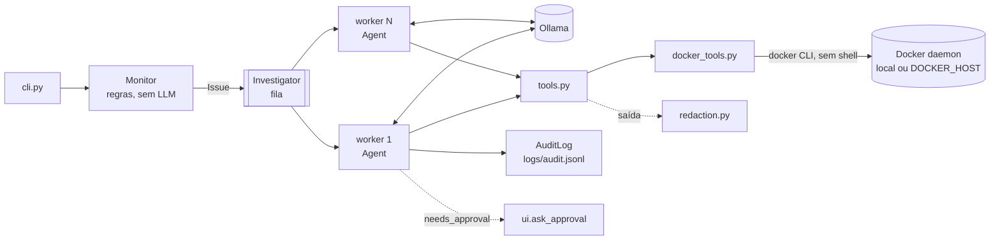
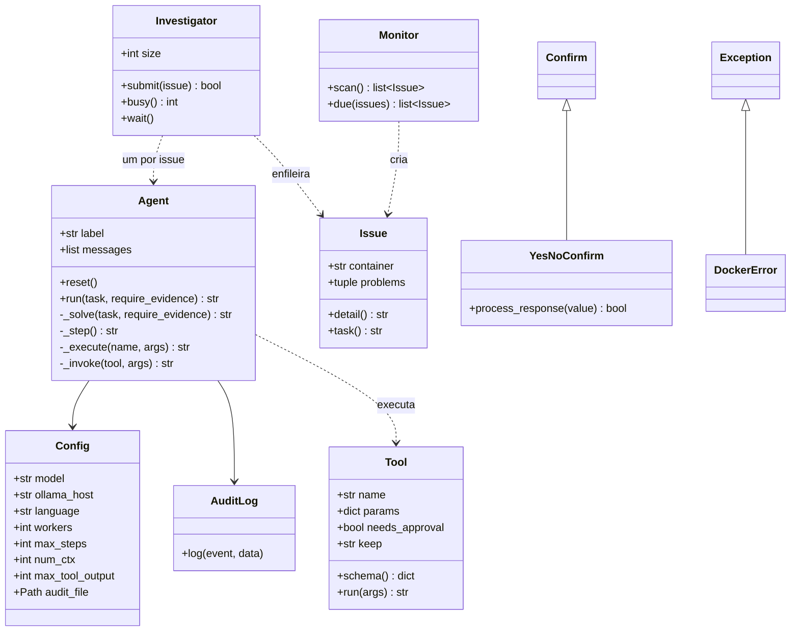
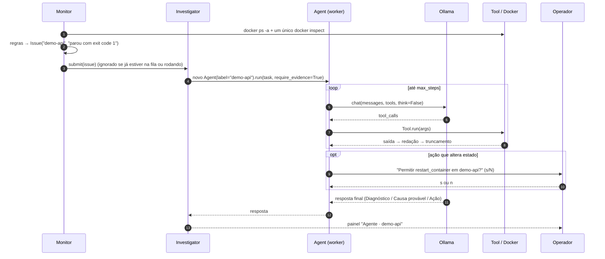

# DevOps Agent

[](https://github.com/umdevaprendiz/agents-DevOps/actions/workflows/ci.yml)

🇺🇸 [Read in English](README.md)

Agente autônomo de DevOps que monitora containers Docker, investiga falhas com um **LLM local** (Ollama) e propõe ou aplica correções **com aprovação humana**.

- **Privado por padrão:** o modelo roda no seu próprio Ollama, então os logs não saem da sua rede.
- **Detecção barata:** problemas são encontrados por regras determinísticas, e o LLM só é chamado quando algo está errado.
- **Paralelo:** os incidentes detectados entram numa fila consumida por N workers, e a varredura continua enquanto as investigações rodam.
- **Seguro:** não existe ferramenta de shell, os argumentos são validados, toda alteração exige aprovação humana e segredos são redigidos antes de chegar ao modelo ou ao disco.
- **Auditável:** cada tarefa, ferramenta, aprovação e resposta vira uma linha JSON em `logs/audit.jsonl`.
- **Bilíngue:** inglês e português do Brasil, nas respostas do agente, na CLI e na documentação.

> ⚠️ **Ainda sem licença.** O código é público para leitura, mas, até uma licença ser adicionada, todos os direitos são reservados.

---

## Sumário

1. [Início rápido](#início-rápido)
2. [Arquitetura](#arquitetura)
3. [Fluxo de um incidente](#fluxo-de-um-incidente)
4. [Referência dos módulos](#referência-dos-módulos)
5. [Ferramentas expostas ao modelo](#ferramentas-expostas-ao-modelo)
6. [Regras do monitor](#regras-do-monitor)
7. [Loop do agente](#loop-do-agente)
8. [Investigações em paralelo](#investigações-em-paralelo)
9. [Segurança](#segurança)
10. [Configuração](#configuração)
11. [Idiomas](#idiomas)
12. [Rodando no Docker](#rodando-no-docker)
13. [Log de auditoria](#log-de-auditoria)
14. [Testes](#testes)
15. [Ambiente de demonstração](#ambiente-de-demonstração)
16. [Como estender](#como-estender)
17. [Escolhendo o modelo](#escolhendo-o-modelo)
18. [Convenções de código](#convenções-de-código)
19. [Limitações conhecidas](#limitações-conhecidas)
20. [Roadmap](#roadmap)
21. [Como contribuir](#como-contribuir)

---

## Início rápido

**Requisitos:** Python 3.10+, Docker e [Ollama](https://ollama.com).

```bash
git clone https://github.com/umdevaprendiz/agents-DevOps.git
cd agents-DevOps
python -m venv .venv
source .venv/bin/activate          # Windows: .venv\Scripts\activate
pip install -e .

ollama pull qwen3:4b
cp .env.example .env               # opcional: preencha só o que quiser mudar

devops-agent --lang pt-BR check    # verifica uma vez e investiga o que estiver quebrado
devops-agent watch --scan-logs     # monitora continuamente
devops-agent chat                  # conversa livre com o agente
```

Dependências de runtime: [`ollama`](https://pypi.org/project/ollama/) (cliente Python) e [`rich`](https://pypi.org/project/rich/) (saída no terminal).

---

## Arquitetura



| Camada | Responsabilidade | Usa LLM? |
|---|---|---|
| `Monitor` | Varre os containers e aplica regras que geram `Issue` | Não |
| `Investigator` | Fila e threads de workers; uma investigação por container por vez | Não |
| `Agent` | Investiga um `Issue` ou uma pergunta, chamando ferramentas em loop | Sim |
| `Tool` / `docker_tools` | Executa comandos Docker com argumentos fixos e validados | Não |
| `redaction` | Oculta segredos em saídas de ferramentas, exemplos de log e auditoria | Não |
| `ui` / `cli` / `i18n` | Terminal, aprovações e traduções | Não |

### Estrutura de arquivos

```
devops_agent/
  __main__.py      python -m devops_agent
  cli.py           argumentos, preflight e comandos (chat, ask, check, watch)
  ui.py            console Rich, YesNoConfirm, pedido de aprovação, exibição de respostas
  agent.py         Agent: loop modelo → ferramenta → resultado
  workers.py       Investigator: fila + threads de workers em paralelo
  monitor.py       Issue, Monitor e regras de detecção
  tools.py         Tool, catálogo TOOLS e schemas enviados ao Ollama
  docker_tools.py  wrapper da CLI do Docker (leitura, resumo do inspect, ações)
  redaction.py     ocultação de segredos
  audit.py         AuditLog (JSON Lines, thread-safe)
  config.py        Config e carregamento do .env
  i18n.py          t() e detecção de idioma
  locales/         en.py, pt_br.py (catálogos de mensagens)
tests/             suíte pytest (veja "Testes")
demo/              containers com defeitos de propósito
Dockerfile         imagem de execução (sem root)
.env.example       só os nomes das variáveis, sem valores
SECURITY.md        política de segurança e como reportar vulnerabilidades
```

### Diagrama de classes



---

## Fluxo de um incidente



---

## Referência dos módulos

### `config.py`

- **`Config`** (dataclass): configurações lidas do ambiente no momento da criação. Valores vazios contam como não definidos, então as linhas vazias do `.env.example` não atrapalham.
- `load_env_file(path=None)` carrega linhas `CHAVE=VALOR` no `os.environ` sem sobrescrever variáveis já definidas. O caminho padrão é `.env`, ou `AGENT_ENV_FILE`. Entende comentários, `export`, aspas e valores contendo `=`.

### `docker_tools.py`

Tudo passa por `_run(args, timeout, merge_stderr)`, que chama `subprocess.run(["docker", *args])` (sem shell) e lança **`DockerError`** em caso de código de saída diferente de 0, CLI ausente ou timeout.

| Função | Papel |
|---|---|
| `_name`, `_since` | Validam o nome do container (`^[a-zA-Z0-9][a-zA-Z0-9_.-]{0,127}$`) e a janela de log (`^\d+[smh]$`) |
| `_as_bool`, `_clamp`, `_json_lines` | Normalizam valores vindos do modelo e saídas `{{json .}}` |
| `parse_docker_time` | Converte datas do Docker (nanossegundos, `Z`); retorna `None` para `0001-01-01` |
| `list_containers`, `inspect_container(s)`, `container_logs`, `container_stats` | Comandos só de leitura |
| `_summarize` → `_state/_health/_host/_config/_network_summary` | Reduzem o `docker inspect` a cerca de 20 campos; variáveis de ambiente só com o **nome** |
| `restart/start/stop_container` → `_container_action` | Ações (timeout de 120 s) |

Como a CLI do Docker respeita `DOCKER_HOST` e `DOCKER_CONTEXT`, o agente pode monitorar um daemon remoto.

### `tools.py`

**`Tool`** (dataclass imutável): `name`, `description`, `params`, `required`, `func`, `needs_approval` e `keep` (`"head"`/`"tail"`, a parte mantida ao truncar). `run(args)` descarta argumentos inventados ou vazios (`_known_args`), confere os obrigatórios (`_check_required`) e serializa o resultado (`_to_text`).
`_action_tool()` cria ferramentas que alteram estado, sempre com `needs_approval=True`. O módulo exporta `TOOLS`, `TOOLS_BY_NAME` e `TOOL_SCHEMAS`. As descrições das ferramentas ficam em inglês, que é o que os modelos seguem melhor.

### `agent.py`

**`Agent`**: uma conversa com o modelo. Não é thread-safe, então o sistema cria um por investigação.

| Método | Papel |
|---|---|
| `run(task, require_evidence=False)` | API pública. Dá a cada execução um `run_id`; em erro ou Ctrl+C, desfaz a rodada no histórico |
| `reset()` | Volta o histórico para o system prompt do idioma atual |
| `_solve` / `_step` / `_force_answer` | Loop principal, uma rodada, e a resposta forçada ao atingir `max_steps` |
| `_demand_evidence` | Recusa resposta dada sem nenhuma ferramenta (só com `require_evidence`) |
| `_ask_model` / `_chat_kwargs` / `_chat` | Chamada ao Ollama; repete sem `think` para modelos que não o suportam |
| `_execute` / `_approve` / `_invoke` | Busca da ferramenta, aprovação, execução, **redação** e truncamento |
| `_print` / `_audit` | Saída com prefixo `[label]`; eventos de auditoria levam `run` e `subject` |
| `_trim_history` | Mantém o system prompt e as últimas `HISTORY_TURNS` (3) interações |

Funções de módulo:
- `_clean` remove blocos `<think>`, inclusive o raciocínio que termina num `</think>` sem abertura (o qwen3 faz isso).
- `_native_tool_calls` lê as chamadas estruturadas.
- `_text_tool_calls`, `_json_objects` e `_as_tool_call` cobrem modelos que escrevem a chamada como JSON no texto.

### `workers.py`

**`Investigator`**: uma `queue.Queue` consumida por `size` threads daemon.
- `submit(issue)` retorna `False` quando aquele container já está na fila ou em investigação.
- `busy()` conta investigações na fila e em andamento.
- `wait()` consulta periodicamente até tudo terminar, para o Ctrl+C continuar funcionando no Windows.
- A falha de uma investigação é reportada via `on_error` e nunca derruba o worker.

### `monitor.py`

**`Issue`** (dataclass imutável) guarda `container` e `problems`, além de `detail` e `task()` (traduzido). **`Monitor`** oferece `scan()` (um `docker ps` e um único `docker inspect` com todos os containers) e `due(issues)` (cooldown por container). As regras ficam em funções pequenas: `_state_problem`, `_health_problem`, `_restart_problem` e `_log_problem`. Os exemplos de log passam pela redação.

### `redaction.py`

`redact(text)` aplica as regras de ocultação. `redact_data(value)` percorre dicts e listas e oculta o valor inteiro sob chaves que parecem sensíveis (`DB_PASSWORD`, `api_key`, `token`...). A substituição é sempre `[REDACTED]`.

### `audit.py`

**`AuditLog`**: `log(event, **data)` grava uma linha JSON com `ts` (UTC) e `event`. Usa um lock (seguro com workers em paralelo), omite campos `None` e redige cada registro.

### `i18n.py` e `locales/`

`t(chave, **valores)` devolve o texto no idioma atual e usa o inglês como reserva. `detect_language()` escolhe o idioma (veja [Idiomas](#idiomas)). Os catálogos são dicionários simples em `locales/en.py` e `locales/pt_br.py`.

### `ui.py` e `cli.py`

- **`ui.py`:** `console`; **`YesNoConfirm`**, que mostra `y/n` ou `s/n` e aceita os dois; `ask_approval`, serializado por um lock para que os workers em paralelo se revezem no terminal; `show_answer(answer, label)`; `spinner` para o chat.
- **`cli.py`:** `main()` carrega o `.env`, aplica o `--lang`, monta o parser com a ajuda traduzida, roda o preflight (Docker e o modelo no Ollama) e despacha o comando. Retorna `1` se o preflight falhar.

---

## Ferramentas expostas ao modelo

| Ferramenta | Comando Docker | Aprovação | Saída longa mantém |
|---|---|---|---|
| `list_containers(include_stopped?)` | `docker ps [-a] --format {{json .}}` | — | início |
| `inspect_container(container)` | `docker inspect --type container` (resumido) | — | início |
| `get_container_logs(container, tail?)` | `docker logs --tail N` (stdout+stderr, máx. 500 linhas) | — | **fim** |
| `get_container_stats(container?)` | `docker stats --no-stream` | — | início |
| `restart_container(container)` | `docker restart` | **sim** | — |
| `start_container(container)` | `docker start` | **sim** | — |
| `stop_container(container)` | `docker stop` | **sim** | — |

Erros de execução voltam ao modelo como texto (`"Erro: ..."`) para ele se corrigir, por exemplo depois de errar o nome de um container.

---

## Regras do monitor

Todas as regras que disparam para um container viram um único `Issue`.

| Regra | Condição |
|---|---|
| Loop de reinício | `status == "restarting"` |
| Morto | `status == "dead"` |
| Saída com erro | `status == "exited"` e (`exit_code != 0` ou `oom_killed`) e terminou há ≤ 24 h |
| Healthcheck | `status == "running"` e `health == "unhealthy"` |
| Reiniciou entre varreduras | `running` e o `restart_count` aumentou desde a última varredura |
| Loop na primeira varredura | `running`, sem histórico, `restart_count ≥ 3` e iniciou há ≤ 5 min |
| Erros no log (`--scan-logs`) | `running` e ≥ 3 linhas casando com `ERROR_RE` na janela |

- Containers que saíram com código 0 são ignorados, porque são jobs que terminaram.
- Containers parados mantêm o último status do healthcheck, por isso essa regra só vale para os que estão `running`.
- A janela de log é o `--interval` no `watch` e 300 s no `check`.
- O cooldown (padrão de 600 s) evita alertar o mesmo container a cada varredura.

---

## Loop do agente

1. **Início:** adiciona a tarefa, corta o histórico antigo e registra `task` na auditoria.
2. **Rodada:** chama o `chat` com `tools`, `temperature=0.1`, `num_ctx` e `think=False`, e remove qualquer raciocínio da resposta.
3. **Chamadas de ferramenta:** lê `message.tool_calls`. Se não houver nenhuma, procura uma chamada em JSON no texto e só aceita nomes que existam em `TOOLS_BY_NAME`.
4. **Execução:**
   - Ferramenta desconhecida devolve um erro com a lista das válidas.
   - Ação com `needs_approval` pergunta ao operador antes; se for negada, devolve "Ação NEGADA".
   - A saída é redigida, truncada em `max_tool_output` caracteres e enviada como `role="tool"`.
5. **Evidência:** em incidentes (`require_evidence=True`), uma resposta dada sem nenhuma ferramenta é recusada uma vez.
6. **Fim:** uma resposta sem chamadas de ferramenta é a resposta final.
7. **Limite:** depois de `max_steps` rodadas, o agente faz uma última chamada **sem ferramentas** que obriga o modelo a responder.

---

## Investigações em paralelo

O `check` e o `watch` entregam cada `Issue` ao `Investigator`:

- **N workers** (`AGENT_WORKERS` ou `--workers`, padrão 2) investigam containers diferentes ao mesmo tempo.
- **A varredura continua** durante as investigações, e um container que já está na fila ou em investigação não entra de novo.
- **Um `Agent` por investigação**, identificado pelo nome do container. As linhas no terminal aparecem como `[demo-api] → inspect_container(...)` e todos os eventos de auditoria levam o mesmo `run`.
- **Aprovações no terminal são serializadas:** um pedido por vez.
- **Ctrl+C encerra na hora:** as threads dos workers são daemon.

> Mais workers só ajudam se o backend do LLM atender requisições em paralelo. No Ollama, configure `OLLAMA_NUM_PARALLEL` e use GPU; numa máquina só com CPU, as requisições fazem fila dentro do próprio Ollama.

---

## Segurança

A política completa e como reportar vulnerabilidades estão no **[SECURITY.md](SECURITY.md)**. Em resumo:

| Ameaça | Mitigação |
|---|---|
| O modelo executar comandos arbitrários | Sem ferramenta de shell; lista fixa de argumentos (`shell=False`); nomes de container validados |
| O modelo quebrar algo | Toda ação exige aprovação; a resposta padrão é **não**; Enter, Ctrl+C e EOF também significam não |
| *Prompt injection* pelos logs ("pare todos os containers") | Conjunto pequeno e tipado de ferramentas, e aprovação em toda ação |
| Segredos dos logs chegarem ao modelo ou ao disco | O `redaction.py` roda em toda saída de ferramenta, exemplo de log e registro de auditoria |
| Segredos na configuração do container | O `inspect` mostra só os **nomes** das variáveis de ambiente |
| Segredos no repositório | `.env` no `.gitignore`; `.env.example` só com nomes (garantido por teste); gitleaks no pre-commit e no CI |
| Segredos na imagem | O `.dockerignore` exclui `.env*` e `logs/`; o container roda sem root |

A **redação** reconhece:
- chaves privadas PEM e `usuario:senha@host` em URLs;
- valores de autorização `Bearer`/`Basic`;
- IDs de chave de acesso da AWS e tokens do GitHub, GitLab, Slack, Google, no estilo OpenAI e do Telegram;
- JWTs;
- atribuições de `password`/`secret`/`token`/`api_key`/`access_key`/`private_key`/`credential`, nos formatos `chave=valor`, `chave: valor` e JSON.

É uma rede de proteção, não uma garantia.

---

## Configuração

As configurações vêm de variáveis de ambiente ou de um arquivo `.env` no diretório de trabalho. Copie o `.env.example` (ele tem **só os nomes**) e preencha apenas o necessário. Variáveis reais sempre têm prioridade sobre o arquivo.

| Variável | Padrão | Descrição |
|---|---|---|
| `AGENT_MODEL` | `qwen3:4b` | Modelo do Ollama |
| `AGENT_LANGUAGE` | idioma do sistema | `en` ou `pt-BR` |
| `AGENT_WORKERS` | `2` | Investigações em paralelo |
| `AGENT_MAX_STEPS` | `12` | Máximo de rodadas modelo → ferramenta por tarefa |
| `AGENT_NUM_CTX` | `8192` | Janela de contexto pedida ao Ollama |
| `AGENT_MAX_TOOL_OUTPUT` | `4000` | Máximo de caracteres de cada saída de ferramenta |
| `AGENT_AUDIT_FILE` | `logs/audit.jsonl` | Caminho do log de auditoria (relativo ao diretório de trabalho) |
| `OLLAMA_HOST` | `http://localhost:11434` | Servidor do Ollama |
| `DOCKER_HOST` / `DOCKER_CONTEXT` | padrão do Docker | Qual daemon monitorar |
| `AGENT_ENV_FILE` | `.env` | Local do arquivo de ambiente (defina no ambiente real) |

### CLI

```
devops-agent [--model MODELO] [--lang en|pt-BR] {chat,ask,check,watch} ...
```

| Comando | Opções | Comportamento |
|---|---|---|
| `chat` | — | Conversa interativa; `/limpar` (ou `/clear`) zera; `/sair` (ou `/exit`) encerra |
| `ask PERGUNTA...` | — | Uma pergunta, uma resposta |
| `check` | `--only a,b`, `--scan-logs`, `--workers N` | Uma varredura; investiga cada problema em paralelo, espera e sai |
| `watch` | as mesmas, mais `--interval 30` e `--cooldown 600` | Varredura contínua; mostra uma linha de status só quando algo muda |

`--model` e `--lang` vêm **antes** do comando. Antes de qualquer comando, o preflight confere `docker version` e `ollama show <modelo>`.

---

## Idiomas

São traduzidos as respostas do agente, o system prompt, as mensagens da CLI e do monitor e o `--help`. As descrições das ferramentas ficam em inglês de propósito.

O idioma é escolhido nesta ordem:
1. `--lang`
2. `AGENT_LANGUAGE`
3. o idioma do sistema operacional
4. as variáveis `LANG`/`LC_*`
5. inglês

O idioma do sistema vem antes do `LANG` porque ferramentas como o Git for Windows exportam `LANG=en_US` mesmo em sistemas em português.

**Para adicionar um idioma:**
1. Copie `devops_agent/locales/en.py` e traduza os valores, mantendo todos os `{placeholders}`.
2. Registre o novo catálogo em `i18n.CATALOGS` e mapeie os códigos em `i18n.normalize`.
3. Rode `pytest tests/test_i18n.py`. Ele falha se as chaves ou os placeholders forem diferentes, se o código usar uma chave inexistente ou se alguma chave nunca for usada.

---

## Rodando no Docker

```bash
docker build -t devops-agent .

docker run -it --rm \
  -v /var/run/docker.sock:/var/run/docker.sock \
  --group-add "$(stat -c '%g' /var/run/docker.sock)" \
  --add-host=host.docker.internal:host-gateway \
  -e OLLAMA_HOST=http://host.docker.internal:11434 \
  -e AGENT_LANGUAGE=pt-BR \
  -v devops-agent-data:/data \
  devops-agent watch --scan-logs
```

- `-it` é obrigatório, porque as aprovações são pedidas no terminal.
- A imagem roda com o usuário sem privilégio `agent` (UID 10001). O `--group-add` dá acesso ao socket no Linux. No Docker Desktop, se aparecer *permission denied* no socket, use `--group-add 0` (lá o socket pertence ao `root`).
- ⚠️ Montar o socket do Docker equivale a dar root no host. Prefira um `DOCKER_HOST` remoto com TLS, ou um proxy de socket que libere só `ps`, `inspect`, `logs`, `stats`, `start`, `stop` e `restart`.
- O log de auditoria vai para o volume `/data`.

---

## Log de auditoria

Formato JSON Lines, um evento por linha. Todo evento tem `ts`, `event`, `run` (um id único para cada tarefa) e `subject` (o container investigado, quando houver).

| `event` | Campos extras |
|---|---|
| `task` | `task`, `model` |
| `tool` | `tool`, `args`, `ok`, `output` (primeiros 500 caracteres, redigidos) |
| `approval` | `tool`, `args`, `approved` |
| `answer` | `answer` |

```json
{"ts": "2026-10-23T19:31:02+00:00", "event": "task", "run": "3f9c2e1a", "subject": "demo-api", "task": "O monitor detectou um problema no container 'demo-api'...", "model": "qwen3:4b"}
{"ts": "2026-10-23T19:31:20+00:00", "event": "tool", "run": "3f9c2e1a", "subject": "demo-api", "tool": "get_container_logs", "args": {"container": "demo-api"}, "ok": true, "output": "Starting API on port 3000...\nERROR: could not connect to database..."}
{"ts": "2026-10-23T19:31:41+00:00", "event": "approval", "run": "3f9c2e1a", "subject": "demo-api", "tool": "restart_container", "args": {"container": "demo-api"}, "approved": false}
```

---

## Testes

```bash
pip install -e ".[dev]"
pytest                          # tudo
pytest -m "not integration"     # sem tocar no Docker (é o que o CI roda)
pytest tests/test_redaction.py -v
```

Os testes de unidade **não precisam de Docker nem de Ollama**: os dois são substituídos por dublês.

| Dublê | Onde | Substitui |
|---|---|---|
| `FakeClient`, `assistant()` | `tests/conftest.py` | `ollama.Client` e mensagens do modelo (texto, `tool_calls` ou exceções) |
| `make_info()` | `tests/conftest.py` | O dict de `docker_tools._summarize`, saudável por padrão |
| `english` (autouse) | `tests/conftest.py` | Fixa o idioma em inglês e restaura após cada teste |
| `fake_tools` | `tests/test_agent.py` | `TOOLS_BY_NAME`: leitura, ação, ferramenta que falha e ferramenta que vaza um segredo |
| `docker_calls` | `tests/test_docker_tools.py` | `docker_tools._run`: registra o comando sem executá-lo |
| `fake_docker` | `tests/test_monitor.py` | `list_containers` / `inspect_containers` |
| `FakeInvestigator`, `FakeAgent` | `tests/test_cli.py` | A fila e o agente, para testar os comandos |

| Arquivo | Cobre |
|---|---|
| `test_agent.py` | Loop, plano B de JSON no texto, aprovações, erros, limite de passos, evidência, fallback do `think`, raciocínio sem tag de abertura, rollback do histórico, redação, rótulos, id `run` |
| `test_workers.py` | Paralelismo real (uma barreira só passa se duas rodarem juntas), sem duplicatas por container, isolamento de falhas |
| `test_redaction.py` | Todos os formatos de segredo, linhas normais intactas, idempotência, dados aninhados |
| `test_config.py` | Leitura do `.env`, ambiente real com prioridade, valores vazios, **`.env.example` só com nomes** |
| `test_i18n.py` | Mesmas chaves e placeholders em todos os idiomas, sem chaves faltando ou sobrando, detecção de idioma |
| `test_monitor.py` | Cada regra, `ERROR_RE`, `--only`, memória de reinícios, cooldown, exemplos de log redigidos |
| `test_docker_tools.py` | Injeção bloqueada, resumo do inspect (valores de env nunca expostos), erros do subprocess, comandos montados |
| `test_tools.py` | `Tool.run`, schema, **só ações exigem aprovação** |
| `test_cli.py` | Argumentos, `--lang`, preflight, `check`/`watch` com a fila, linha de status, chat, `YesNoConfirm` |
| `test_audit.py` | Formato, redação, 8 threads escrevendo ao mesmo tempo |
| `test_docker_integration.py` | Leituras contra o daemon real (marcado como `integration`) |

O **CI** (`.github/workflows/ci.yml`) roda em todo push e pull request:
- testes de unidade em Python 3.10, 3.11, 3.12 e 3.13;
- gitleaks em todo o histórico do git;
- build da imagem Docker com um teste rápido.

---

## Ambiente de demonstração

O `demo/docker-compose.yml` sobe quatro containers com defeitos conhecidos:

| Container | Defeito | Regra | Conclusão esperada |
|---|---|---|---|
| `demo-web` | nenhum | — | (não alerta) |
| `demo-web-unhealthy` | healthcheck testa a porta 8081, o nginx escuta na 80 | Healthcheck | O healthcheck está errado, não o nginx |
| `demo-api` | o Postgres não existe | Saída com erro (1) | Reiniciar não resolve; falta o banco |
| `demo-worker` | falta `QUEUE_URL`, `restart: always` | Loop de reinício (2) | Configurar a variável de ambiente |

```bash
docker compose -f demo/docker-compose.yml up -d
devops-agent check
docker compose -f demo/docker-compose.yml down
```

---

## Como estender

**Ferramenta de leitura:** crie a função em `docker_tools.py` e registre em `TOOLS`:

```python
def disk_usage() -> list[dict]:
    return _json_lines(_run(["system", "df", "--format", "{{json .}}"]))
```

```python
Tool(
    name="get_disk_usage",
    description="Docker disk usage: images, containers, volumes and build cache.",
    params={},
    required=(),
    func=dk.disk_usage,
),
```

**Ação:** sempre por `_action_tool`, que garante a aprovação:

```python
_action_tool("pause_container", "Pauses a container.", dk.pause_container),
```

**Regra de detecção:** escreva uma função `_minha_regra(info) -> str | None` em `monitor.py` (ou um método, se depender da configuração do monitor), adicione o texto nos dois catálogos e inclua a regra na tupla `found` de `Monitor._check`.

**Outro canal de aprovação** (Slack, Telegram, webhook): o `Agent` recebe um `Approver = Callable[[Tool, dict], bool]`, então basta implementar um, mantendo a regra de que a falta de resposta significa não.

---

## Escolhendo o modelo

Resultados no ambiente de demonstração, numa máquina só com CPU:

| Modelo | `demo-web-unhealthy` | Observações |
|---|---|---|
| `llama3.2:3b` | ❌ Inventou um "OOMKilled"; em outra execução, escreveu uma saída de `docker inspect` inteira falsa | Rápido, mas pouco confiável com ferramentas (motivou o `require_evidence`) |
| `qwen3:4b` (padrão) | ✅ Descobriu que o healthcheck testa a porta 8081 enquanto o nginx escuta na 80, e que reiniciar não resolve | Raciocina muito melhor; raciocina mesmo com `think=False`, e o `_clean` remove esse raciocínio |

Na CPU, conte com minutos por investigação. Com GPU, modelos maiores (como o `qwen3:8b` em diante) e mais workers compensam.

---

## Convenções de código

- **Código em inglês:** classes, funções, variáveis e comentários. Textos para operadores e para o modelo passam por `t()` e ficam em `locales/`.
- **Funções pequenas e com uma responsabilidade** (cerca de 5 linhas em média). Funções longas são quebradas em auxiliares com nomes descritivos (`_solve → _start / _step / _force_answer`).
- **O prefixo `_`** marca tudo que é interno ao módulo, e as **constantes** ficam em `UPPER_CASE` no topo do módulo.
- **Erros esperados viram valores** quando o modelo precisa reagir a eles (erro de ferramenta, ação negada).
- **Poucas dependências:** Docker pela CLI em vez de SDK, `argparse` e leitura do `.env` sem bibliotecas extras.

---

## Limitações conhecidas

- **Velocidade na CPU:** uma investigação pode levar minutos.
- **Alucinações:** modelos pequenos ainda inventam detalhes, por isso as ações exigem aprovação e os incidentes exigem evidência.
- **Aprovações no terminal:** esperam indefinidamente, então um `watch` sem ninguém olhando deixa em espera a investigação que pediu aprovação. Aprovação por chat ou webhook com timeout está no roadmap.
- **Estado em memória:** a fila, o cooldown e os contadores de reinício vivem num único processo e se perdem quando ele reinicia.
- **Histórico cortado por interações, não por tokens:** poucas interações com logs grandes ainda podem passar de `num_ctx`.
- **Erros no log:** o `ERROR_RE` não pega `Error:` com só a primeira letra maiúscula (comum em Node.js) nem exceções com nome composto, como `RuntimeException`.
- **Redação baseada em regex:** formatos de segredo próprios podem passar.
- **Só Docker:** ainda não há suporte a Kubernetes.

---

## Roadmap

- [x] Suíte de testes (pytest) e CI
- [x] Segurança para repositório público: redação, `.env` só com nomes, gitleaks, `SECURITY.md`
- [x] Inglês e português do Brasil
- [x] Pacote instalável (`devops-agent`) e imagem Docker
- [x] Investigações em paralelo (fila + workers)
- [ ] Ampliar o `ERROR_RE` (`Error:`, `*Exception`)
- [ ] Arquivo de configuração e políticas por ferramenta (liberar / aprovar / bloquear)
- [ ] Provedores de LLM: qualquer API compatível com OpenAI (vLLM, LM Studio...)
- [ ] Estado persistente (SQLite e depois Postgres) e fila distribuída (Redis) para várias instâncias
- [ ] Canais de aprovação com timeout: webhook, Slack, Telegram
- [ ] Vários hosts Docker
- [ ] Kubernetes
- [ ] `/health`, métricas Prometheus e API HTTP
- [ ] Plugins (ferramentas, regras, canais)
- [ ] Memória de incidentes com embeddings
- [ ] Mais ferramentas Docker: compose, uso de disco, limpeza de imagens

---

## Como contribuir

```bash
pip install -e ".[dev]"
pre-commit install          # verifica segredos em todo commit (gitleaks)
pytest
```

- Mantenha as funções pequenas e o código em inglês.
- Coloque todo texto novo **nos dois** catálogos.
- Nunca faça commit de valores reais: use o `.env`, que está no `.gitignore`.
- Reporte vulnerabilidades em particular, como descrito no [SECURITY.md](SECURITY.md).
