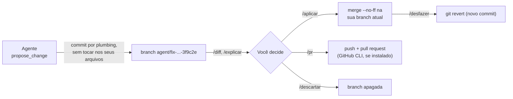
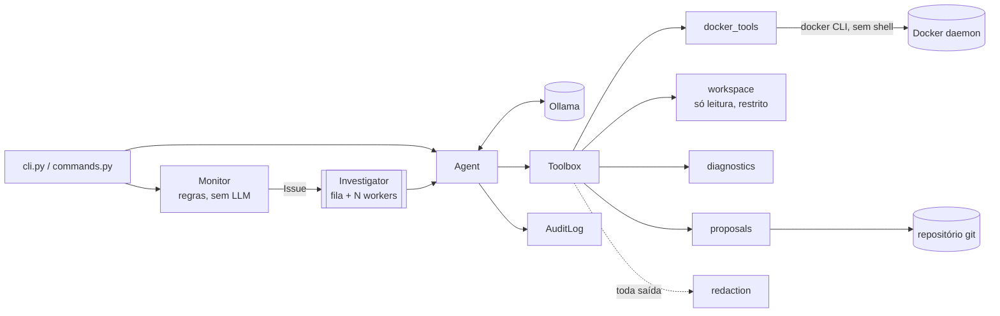

# DevOps Agent

🇺🇸 [Read in English](README.md)

Agente autônomo de DevOps que **depura** seus containers e seu projeto com um **LLM local** (Ollama). Ele descobre o que está falhando, explica cada bug (o erro, a causa e como resolver) e **propõe a correção numa branch do git**, que você revisa e junta na sua branch ou transforma em pull request.

- **Depuração de ponta a ponta:** containers, logs dos containers, arquivos de log do projeto, Dockerfiles, compose, CI, configuração e código.
- **Explica como um engenheiro:** cada problema vem como *Problema → Erro → Causa → Como resolver → Mudança proposta*.
- **Corrige pelo git:** cada correção é um commit numa branch própria `agent/...`. Seus arquivos não mudam até você rodar `/apply`, ou você roda `/pr` para abrir um pull request.
- **Privado por padrão:** o modelo roda no seu Ollama, então logs e código não saem da sua rede.
- **Seguro:**
  - não existe ferramenta de shell;
  - o acesso a arquivos é restrito ao projeto, e arquivos de segredo nunca são lidos;
  - segredos são redigidos antes de chegar ao modelo;
  - ações em containers exigem sua aprovação.
- **Paralelo e auditável:** uma fila de incidentes é atendida por N workers, e cada passo vira uma linha JSON em `logs/audit.jsonl`.
- **Bilíngue:** inglês e português do Brasil.

> ⚠️ **Ainda sem licença.** O código é público para leitura, mas, até uma licença ser adicionada, todos os direitos são reservados.

---

## Sumário

1. [Início rápido](#início-rápido)
2. [Depuração](#depuração)
3. [Comandos do chat](#comandos-do-chat)
4. [Propostas de mudança (fluxo git)](#propostas-de-mudança-fluxo-git)
5. [Arquitetura](#arquitetura)
6. [Referência dos módulos](#referência-dos-módulos)
7. [Ferramentas expostas ao modelo](#ferramentas-expostas-ao-modelo)
8. [Regras do monitor](#regras-do-monitor)
9. [Loop do agente](#loop-do-agente)
10. [Investigações em paralelo](#investigações-em-paralelo)
11. [Segurança](#segurança)
12. [Configuração](#configuração)
13. [Idiomas](#idiomas)
14. [Rodando no Docker](#rodando-no-docker)
15. [Log de auditoria](#log-de-auditoria)
16. [Testes](#testes)
17. [Ambiente de demonstração](#ambiente-de-demonstração)
18. [Como estender](#como-estender)
19. [Escolhendo o modelo](#escolhendo-o-modelo)
20. [Convenções de código](#convenções-de-código)
21. [Limitações conhecidas](#limitações-conhecidas)
22. [Roadmap](#roadmap)
23. [Como contribuir](#como-contribuir)

---

## Início rápido

**Requisitos:** Python 3.10+, Docker, git e [Ollama](https://ollama.com).

```bash
git clone https://github.com/umdevaprendiz/agents-DevOps.git
cd agents-DevOps
python -m venv .venv
source .venv/bin/activate          # Windows: .venv\Scripts\activate
pip install -e .
ollama pull qwen3:4b
cp .env.example .env               # opcional: preencha só o que quiser mudar
```

Depois aponte o agente para o **seu** projeto (qualquer repositório git) e depure:

```bash
cd /caminho/do/seu/projeto         # ou defina AGENT_WORKSPACE
devops-agent --lang pt-BR debug    # descobre o que falha, explica e propõe correções
devops-agent debug api timeout     # o mesmo, com foco num container, arquivo ou sintoma
devops-agent chat                  # interativo: /depurar, /diff, /explicar, /aplicar, /pr...
devops-agent watch --scan-logs     # monitora os containers e investiga incidentes
```

---

## Depuração

`devops-agent debug [foco]`, ou `/debug [foco]` no chat, roda uma sessão completa de depuração:

1. **`collect_diagnostics`** junta numa chamada só, sem LLM:
   - containers com problema e suas últimas linhas de erro;
   - linhas de erro nos arquivos de log do projeto (`*.log`, inclusive os que estão no `.gitignore`);
   - os arquivos de infraestrutura do projeto (Dockerfiles, compose, CI, Kubernetes, Terraform, nginx...).
2. **O modelo investiga cada problema a fundo:** logs e `inspect` dos containers, mais os arquivos do projeto relacionados (`read_file`, `search_files`, `git_diff`...).
3. **Ele explica cada problema** num formato fixo:

   ```
   **Problema:** demo-web-unhealthy está marcado como unhealthy
   **Erro:** wget: can't connect to remote host: Connection refused (healthcheck, 650 falhas seguidas)
   **Causa:** o healthcheck testa http://localhost:8081/, mas o nginx escuta na porta 80
   **Como resolver:** apontar o healthcheck para a porta 80 no docker-compose.yml e rodar docker compose up -d web-unhealthy
   **Mudança proposta:** 3f9c2e
   ```

4. **Quando uma mudança em arquivo resolve, ele chama `propose_change`** com a menor edição possível. Reiniciar não resolve um erro de configuração, por isso o agente é instruído a não sugerir isso nesses casos. Quando a solução é uma ação, como subir um banco ou definir uma variável no host, ele mostra o comando exato.

Os incidentes encontrados pelo `check`/`watch` seguem o mesmo caminho: diagnóstico nesse formato e, quando uma mudança em arquivo resolve, uma correção proposta.

---

## Comandos do chat

O `devops-agent chat` funciona como um assistente de código: você conversa com o agente e usa comandos com `/`. Todo comando tem nome em inglês e um apelido em português.

| Comando | Apelido | O que faz |
|---|---|---|
| `/help` | `/ajuda` | Lista os comandos |
| `/debug [foco]` | `/depurar` | Descobre o que está falhando (containers, logs, projeto), explica cada bug e propõe correções |
| `/suggest [foco]` | `/sugerir` | Revisa o projeto e propõe **só as mudanças necessárias** (bugs, riscos de segurança, configuração errada) |
| `/proposals` | `/propostas` | Lista as propostas pendentes |
| `/diff [id]` | — | Mostra as alterações de uma proposta (padrão: a mais recente) |
| `/explain [id]` | `/explicar` | O agente explica a proposta: o que muda, por quê, riscos, como testar |
| `/apply [id]` | `/aplicar` | Junta a proposta na sua branch atual (pede confirmação) |
| `/pr [id]` | — | Envia a branch da proposta e abre um pull request (pede confirmação) |
| `/discard [id]` | `/descartar` | Apaga uma proposta |
| `/undo` | `/desfazer` | Reverte a última proposta aplicada com um novo commit |
| `/status` | — | Modelo, idioma, workspace, branch e propostas pendentes |
| `/clear` | `/limpar` | Limpa a conversa |
| `/exit` | `/sair`, `/quit` | Sai |

Qualquer texto que não comece com `/` é uma pergunta normal ao agente ("por que o worker está reiniciando?", "a config do nginx está segura?").

---

## Propostas de mudança (fluxo git)



- **Cada proposta é um commit numa branch própria** `agent/<titulo>-<id>`, com o autor `DevOps Agent <devops-agent@users.noreply.localhost>`, para ficar fácil diferenciar dos commits humanos.
- **Ao propor, nada é tocado:** nem seus arquivos, nem o índice, nem a sua branch atual. O commit é montado com um índice temporário (`read-tree` → `hash-object` → `update-index` → `write-tree` → `commit-tree`).
- **As edições são substituições exatas:** o `old_text` precisa aparecer uma única vez no arquivo, e `old_text=''` cria um arquivo novo. O agente também lida com arquivos CRLF e com números de linha que o modelo copiou sem querer (`12| `). Ele recusa:
  - caminhos fora do workspace;
  - arquivos de segredo;
  - linhas com `[REDACTED]`;
  - texto novo que pareça um segredo (o modelo deve usar referências `${VARIAVEL}`).
- **`/aplicar`** roda `git merge --no-ff` com a sua identidade do git e depois apaga a branch da proposta. Se houver conflito, o merge é abortado e o repositório fica como estava.
- **`/desfazer`** reverte a última proposta aplicada com `git revert -m 1`, então o histórico é mantido.
- **`/pr`** pede confirmação, envia a branch e roda `gh pr create` se o GitHub CLI estiver instalado. Sem ele, o agente diz de qual branch abrir o PR.
- **O agente nunca faz commit na sua branch nem push por conta própria.**

---

## Arquitetura



### Estrutura de arquivos

```
devops_agent/
  cli.py           argumentos, preflight e comandos (chat, ask, debug, check, watch)
  commands.py      loop do chat e comandos /; sessões debug() e suggest()
  agent.py         Agent: loop modelo → ferramenta → resultado
  tools.py         Tool, Toolbox e todas as ferramentas expostas ao modelo
  docker_tools.py  wrapper da CLI do Docker
  workspace.py     acesso restrito e só de leitura aos arquivos do projeto
  diagnostics.py   relatório determinístico (containers, arquivos de log, infraestrutura)
  git_tools.py     wrapper da CLI do git, incluindo commits por plumbing
  proposals.py     propostas: criar, diff, aplicar, pull request, descartar, desfazer
  monitor.py       Issue, Monitor e regras de detecção
  workers.py       Investigator: fila + threads de workers em paralelo
  redaction.py     ocultação de segredos
  audit.py         AuditLog (JSON Lines, thread-safe)
  ui.py            console Rich, confirmações, exibição de diffs e tabelas
  config.py        Config e carregamento do .env
  i18n.py, locales/  traduções (en, pt-BR)
tests/             suíte pytest
demo/              containers com defeitos de propósito
```

---

## Referência dos módulos

| Módulo | Partes principais |
|---|---|
| `workspace.py` | **`Workspace`**: `resolve` (recusa escapes e arquivos de segredo), `list_files`, `read_file` (linhas numeradas), `search` (regex, com texto puro como reserva), `git_status`/`git_log`/`git_diff` (sem arquivos de segredo), `log_files` e `tail_lines` (logs enormes). **`WorkspaceError`**. |
| `diagnostics.py` | `collect(workspace)`: containers com problema e suas últimas linhas de erro, arquivos de log do projeto com erros, arquivos de infraestrutura. |
| `git_tools.py` | `_git` (lista de argumentos, sem shell, `GIT_TERMINAL_PROMPT=0`, bytes para preservar CRLF); `commit_files` (commit por plumbing com a identidade do agente); `merge`/`revert_merge` (abortam em conflito); `branches`, `read_blob`, `push`... **`GitError`**. |
| `proposals.py` | **`ProposalStore`**: `create`, `pending`, `get`, `diff`, `apply`, `discard`, `undo_last`, `open_pull_request`. **`Proposal`**, **`Edit`**, `parse_edits` (aceita lista, dict ou string JSON), `apply_edit`. **`ProposalError`**. |
| `commands.py` | **`Session`**, **`Command`**, `COMMANDS`, `dispatch`, `handle_input`, `run_chat`, `debug`, `suggest`, `ask_agent`. |
| `tools.py` | **`Tool`**, **`Toolbox`**, `DOCKER_TOOLS`, `workspace_tools`, `diagnostics_tool`, `proposal_tool`, `build_toolbox`. |
| `agent.py` | **`Agent`**: `run(task, require_evidence)` e passos privados pequenos (`_step`, `_execute`, `_approve`, `_invoke`...). Recebe uma `Toolbox`. |
| `monitor.py`, `workers.py`, `redaction.py`, `audit.py`, `config.py`, `i18n.py`, `ui.py`, `docker_tools.py` | Responsabilidades de antes: regras, fila paralela, ocultação, auditoria, configuração, traduções, terminal e CLI do Docker. |

---

## Ferramentas expostas ao modelo

| Ferramenta | O que faz | Aprovação |
|---|---|---|
| `collect_diagnostics()` | Ponto de partida: containers com problema, erros em arquivos de log, arquivos de infraestrutura | — |
| `list_containers`, `inspect_container`, `get_container_logs`, `get_container_stats` | Leituras do Docker (o `inspect` mostra só os **nomes** das variáveis) | — |
| `list_files(pattern?)` | Arquivos do projeto (respeita o `.gitignore`; esconde segredos; até 300) | — |
| `read_file(path, start_line?, max_lines?)` | Arquivo com linhas numeradas (`12| `), até 500 linhas, máx. 512 KB, só texto | — |
| `search_files(pattern, glob?)` | Busca por regex no projeto (`caminho:linha: texto`, até 60 resultados) | — |
| `git_status`, `git_log(limit?)`, `git_diff(path?)` | Estado do repositório e alterações sem commit (sem arquivos de segredo) | — |
| `propose_change(title, explanation, edits)` | Faz o commit de uma correção numa nova branch `agent/...`; você decide depois | — (você decide com `/aplicar` ou `/pr`) |
| `restart_container`, `start_container`, `stop_container` | Ações em containers | **sim** |

---

## Regras do monitor

Todas as regras que disparam para um container viram um único `Issue`.

| Regra | Condição |
|---|---|
| Loop de reinício | `status == "restarting"` |
| Morto | `status == "dead"` |
| Saída com erro | `exited` e (`exit_code != 0` ou `oom_killed`) e terminou há ≤ 24 h |
| Healthcheck | `running` e `health == "unhealthy"` |
| Reiniciou entre varreduras | `running` e o `restart_count` aumentou desde a última varredura |
| Loop na primeira varredura | `running`, sem histórico, `restart_count ≥ 3` e iniciou há ≤ 5 min |
| Erros no log (`--scan-logs`) | `running` e ≥ 3 linhas casando com `ERROR_RE` na janela |

O `ERROR_RE` reconhece:
- níveis em maiúsculas (`ERROR`, `FATAL`, `CRITICAL`, `PANIC`);
- `Error:` / `TypeError:` / `Fatal:`;
- o `panic:` do Go;
- tracebacks do Python;
- nomes terminados em `Exception` (`RuntimeException`, `NullPointerException`...);
- logs estruturados com `level=error` / `"level":"error"`.

---

## Loop do agente

1. **Início:** adiciona a tarefa, corta o histórico antigo e registra `task` na auditoria.
2. **Rodada:** chama o `chat` com a toolbox, `temperature=0.1`, `num_ctx` e `think=False`, e remove qualquer raciocínio, inclusive o do qwen3, que termina num `</think>` sem abertura.
3. **Chamadas de ferramenta:** usa os `tool_calls` nativos; se não houver, procura uma chamada em JSON escrita no texto e só aceita nomes de ferramentas conhecidos.
4. **Execução:**
   - Ferramenta desconhecida devolve a lista das válidas.
   - Ações em containers pedem aprovação.
   - Toda saída é **redigida**, truncada e devolvida como `role="tool"`.
5. **Evidência:** em incidentes, uma resposta dada sem usar nenhuma ferramenta é recusada uma vez.
6. **Fim:** a resposta usa o formato *Problema / Erro / Causa / Como resolver / Mudança proposta* para problemas, e um formato livre para o resto.
7. **Limite:** depois de `max_steps` rodadas, uma última chamada sem ferramentas obriga a resposta.

---

## Investigações em paralelo

O `check` e o `watch` entregam cada `Issue` ao `Investigator`:
- N threads de workers (`AGENT_WORKERS` / `--workers`, padrão 2) investigam containers diferentes ao mesmo tempo.
- Um container que já está na fila ou em investigação não entra de novo.
- Cada investigação tem seu próprio `Agent`, identificado pelo nome do container: as linhas aparecem como `[api] → ...` e os registros de auditoria levam o mesmo `run`.
- As aprovações são pedidas uma de cada vez.

> Mais workers só ajudam se o backend do LLM atender em paralelo (Ollama com `OLLAMA_NUM_PARALLEL` e GPU). Numa máquina só com CPU, use `--workers 1`.

---

## Segurança

Política completa no **[SECURITY.md](SECURITY.md)**.

| Ameaça | Mitigação |
|---|---|
| O modelo executar comandos arbitrários | Sem ferramenta de shell; Docker e git sempre com listas fixas de argumentos; nomes de container validados |
| O modelo ler ou vazar segredos | Workspace restrito à sua raiz; `.env*` (exceto `.env.example`), chaves privadas, `.netrc`, `.npmrc`, `.pypirc` e `.git/` nunca são lidos, listados, buscados ou incluídos em diffs; toda saída é redigida |
| O modelo escrever segredos no repositório | O `propose_change` recusa texto novo que pareça segredo e linhas com `[REDACTED]`; o prompt pede referências `${VARIAVEL}` |
| O modelo alterar seu código sem permissão | As propostas ficam em branches separadas; só o `/aplicar` (com confirmação) faz o merge, e o `/desfazer` reverte |
| Push sem permissão | Só pelo `/pr`, depois de confirmar; o git nunca fica esperando pedido de credencial |
| O modelo quebrar containers | Toda ação em container exige aprovação; a resposta padrão é **não** |
| *Prompt injection* por logs ou arquivos | Conjunto pequeno e tipado de ferramentas; nada muda sem sua aprovação |

---

## Configuração

Variáveis de ambiente ou um arquivo `.env` (copie o `.env.example`, que tem **só os nomes**). Variáveis reais têm prioridade sobre o arquivo.

| Variável | Padrão | Descrição |
|---|---|---|
| `AGENT_WORKSPACE` | diretório atual | Projeto que o agente depura e no qual propõe mudanças (um repositório git) |
| `AGENT_MODEL` | `qwen3:4b` | Modelo do Ollama |
| `AGENT_LANGUAGE` | idioma do sistema | `en` ou `pt-BR` |
| `AGENT_WORKERS` | `2` | Investigações em paralelo |
| `AGENT_MAX_STEPS` | `12` | Máximo de rodadas modelo → ferramenta por tarefa |
| `AGENT_NUM_CTX` | `8192` | Janela de contexto pedida ao Ollama |
| `AGENT_MAX_TOOL_OUTPUT` | `4000` | Máximo de caracteres de cada saída de ferramenta |
| `AGENT_AUDIT_FILE` | `logs/audit.jsonl` | Caminho do log de auditoria |
| `OLLAMA_HOST` | `http://localhost:11434` | Servidor do Ollama |
| `DOCKER_HOST` / `DOCKER_CONTEXT` | padrão do Docker | Qual daemon depurar |

```
devops-agent [--model MODELO] [--lang en|pt-BR] {chat,ask,debug,check,watch} ...
```

| Comando | Opções | Comportamento |
|---|---|---|
| `chat` | — | Sessão interativa com comandos `/` |
| `ask PERGUNTA...` | — | Uma pergunta, uma resposta |
| `debug [FOCO...]` | — | Sessão completa de depuração; mostra as propostas para revisar no chat |
| `check` | `--only a,b`, `--scan-logs`, `--workers N` | Uma varredura; investiga cada incidente em paralelo |
| `watch` | as mesmas, mais `--interval 30` e `--cooldown 600` | Varredura contínua |

O preflight confere o Docker, o modelo no Ollama e o workspace. Uma pasta sem git também funciona, mas as propostas de mudança ficam desativadas.

---

## Idiomas

As respostas do modelo, a CLI, os comandos `/` e o `--help` são traduzidos. O idioma é escolhido nesta ordem:
1. `--lang`
2. `AGENT_LANGUAGE`
3. o idioma do sistema operacional
4. `LANG`/`LC_*`
5. inglês

Para adicionar um idioma, copie `locales/en.py`, traduza e registre em `i18n.py`. O `tests/test_i18n.py` garante as mesmas chaves e placeholders em todos os idiomas, e que toda chave seja usada.

---

## Rodando no Docker

```bash
docker build -t devops-agent .
docker run -it --rm \
  -v /var/run/docker.sock:/var/run/docker.sock \
  --group-add "$(stat -c '%g' /var/run/docker.sock)" \
  --add-host=host.docker.internal:host-gateway \
  -e OLLAMA_HOST=http://host.docker.internal:11434 \
  -e AGENT_LANGUAGE=pt-BR \
  -v "$PWD:/workspace" -e AGENT_WORKSPACE=/workspace \
  devops-agent debug
```

- `-it` é necessário para as confirmações.
- A imagem roda com o usuário sem privilégio `agent` (UID 10001). No Docker Desktop, use `--group-add 0` se o socket der *permission denied*.
- ⚠️ Montar o socket do Docker equivale a dar root no host. Prefira um `DOCKER_HOST` remoto com TLS, ou um proxy de socket que libere só os endpoints que o agente usa.

---

## Log de auditoria

JSON Lines. Todo evento tem `ts`, `event`, `run` (um id por tarefa) e `subject` (o container, quando houver).

| `event` | Campos extras |
|---|---|
| `task` | `task`, `model` |
| `tool` | `tool`, `args`, `ok`, `output` (primeiros 500 caracteres, redigidos) |
| `approval` | `tool`, `args`, `approved` |
| `answer` | `answer` |

---

## Testes

```bash
pip install -e ".[dev]"
pytest                          # tudo
pytest -m "not integration"     # sem tocar no Docker (é o que o CI roda)
```

Os testes de unidade **não precisam de Docker nem de Ollama**: usam dublês (`FakeClient`, `assistant()`, `make_info()`, `fake_tools`, `docker_calls`, `fake_docker`). Os testes de git usam repositórios temporários reais (fixture `git_repo`).

| Arquivo | Cobre |
|---|---|
| `test_agent.py` | Loop, chamadas de ferramenta escritas como JSON no texto, aprovações, erros, limite de passos, evidência, fallback do `think`, limpeza do raciocínio, redação, rótulos, auditoria |
| `test_workspace.py` | Restrição de acesso (`../`, caminhos absolutos), arquivos de segredo, `.gitignore`, leitura numerada, limites de tamanho e binário, busca, `git_diff` sem segredos |
| `test_git_tools.py` | Commits por plumbing que nunca tocam nos seus arquivos, identidade do agente, bit de executável, CRLF, merge/revert, conflitos abortados |
| `test_proposals.py` | Edições exatas (única, ambígua, CRLF, números de linha), proteções contra segredos, workspace numa subpasta, aplicar/desfazer/descartar, push para um remoto, **ponta a ponta: o modelo propõe e o operador aplica** |
| `test_diagnostics.py` | Containers com erros, Docker fora do ar, logs no `.gitignore`, logs enormes, arquivos de infraestrutura |
| `test_commands.py` | Todos os comandos e apelidos, `/debug`, `/suggest`, `/diff`, `/explain` (sem enviar segredos), confirmações de `/apply`, `/pr`, `/discard`, `/undo` |
| `test_cli.py`, `test_workers.py`, `test_monitor.py`, `test_docker_tools.py`, `test_tools.py`, `test_redaction.py`, `test_config.py`, `test_i18n.py`, `test_audit.py` | CLI, fila paralela, regras e `ERROR_RE`, wrapper do Docker, toolbox, ocultação (inclusive referências `${VAR}`), `.env`, traduções, auditoria |

O CI roda:
- os testes de unidade em Python 3.10 a 3.13;
- o gitleaks em todo o histórico;
- o build da imagem Docker.

---

## Ambiente de demonstração

O `demo/docker-compose.yml` sobe quatro containers com defeitos conhecidos. Rode `devops-agent debug` dentro deste repositório para ver o agente explicá-los e propor correções.

| Container | Defeito | Diagnóstico esperado |
|---|---|---|
| `demo-web` | nenhum | (não alerta) |
| `demo-web-unhealthy` | healthcheck testa a 8081, o nginx escuta na 80 | Porta errada no healthcheck → proposta editando o `docker-compose.yml` |
| `demo-api` | o Postgres não existe | Reiniciar não resolve; falta o banco |
| `demo-worker` | falta `QUEUE_URL`, `restart: always` | Configurar a variável de ambiente |

---

## Como estender

- **Ferramenta:** adicione um `Tool` em `tools.py`. Ferramentas de leitura não precisam de aprovação. Ações em containers usam `_action_tool`, que garante a aprovação. Mudanças em arquivos passam sempre pelo `propose_change`.
- **Comando do chat:** adicione um `Command(name, aliases, usage, help_key, handler)` em `commands.COMMANDS` e os textos nos dois catálogos.
- **Regra de detecção:** adicione uma função pequena em `monitor.py` e inclua em `Monitor._check`.
- **Canal de aprovação:** o `Agent` recebe um `Approver = Callable[[Tool, dict], bool]`.

---

## Escolhendo o modelo

| Modelo | `demo-web-unhealthy` numa máquina só com CPU |
|---|---|
| `llama3.2:3b` | ❌ Inventou um OOM; uma vez escreveu uma saída de `docker inspect` inteira falsa |
| `qwen3:4b` (padrão) | ✅ Achou a porta errada do healthcheck e viu que reiniciar não resolve; lento na CPU |

Mudanças em código exigem mais contexto e raciocínio do que um diagnóstico. Com GPU, um modelo maior (como o `qwen3:8b` em diante) dá propostas muito melhores.

---

## Convenções de código

- **Código em inglês**, com todo texto passando por `t()` em `locales/`.
- **Funções pequenas e com uma responsabilidade**, e constantes em `UPPER_CASE`.
- **Erros esperados viram valores** para o modelo (erro de ferramenta, edição recusada).
- **Nunca usar shell:** subprocessos sempre recebem listas de argumentos.
- **Poucas dependências:** `ollama` e `rich`.

---

## Limitações conhecidas

- **Velocidade na CPU:** uma sessão de depuração pode levar vários minutos.
- **Alucinações:** modelos pequenos ainda inventam detalhes. Propostas e ações sempre esperam por você.
- **Edições por substituição exata:** grandes refatorações estão fora do escopo de propósito ("só o necessário").
- **Confirmações no terminal:** ainda não há timeout nem canais de aprovação remotos.
- **Estado em memória:** a fila, o cooldown e os contadores de reinício vivem num único processo.
- **Redação baseada em regex:** formatos de segredo próprios podem passar.
- **Só Docker:** ainda não há suporte a Kubernetes.

---

## Roadmap

- [x] Suíte de testes e CI
- [x] Segurança para repositório público (redação, `.env` só com nomes, gitleaks)
- [x] Inglês e português do Brasil
- [x] Pacote instalável e imagem Docker
- [x] Investigações em paralelo
- [x] Sessões de depuração (`debug`, `/debug`, `collect_diagnostics`)
- [x] Comandos `/` e propostas de mudança em branches do git (`/diff`, `/explain`, `/apply`, `/pr`, `/undo`)
- [ ] Modos de permissão (só sugerir / perguntar / automático) e políticas por ferramenta
- [ ] Canais de aprovação com timeout (webhook, Slack, Telegram)
- [ ] Provedores de LLM: qualquer API compatível com OpenAI (vLLM, LM Studio...)
- [ ] Varredura de segurança nos logs (força bruta, acessos suspeitos) e nas configurações (portas expostas, containers como root, tag `latest`)
- [ ] Estado persistente e fila distribuída
- [ ] Vários hosts Docker, depois Kubernetes
- [ ] `/health`, métricas Prometheus, API HTTP

---

## Como contribuir

```bash
pip install -e ".[dev]"
pre-commit install          # gitleaks em todo commit
pytest
```

- Mantenha as funções pequenas e o código em inglês.
- Coloque todo texto novo **nos dois** catálogos.
- Nunca faça commit de valores reais.
- Reporte vulnerabilidades em particular, como descrito no [SECURITY.md](SECURITY.md).
